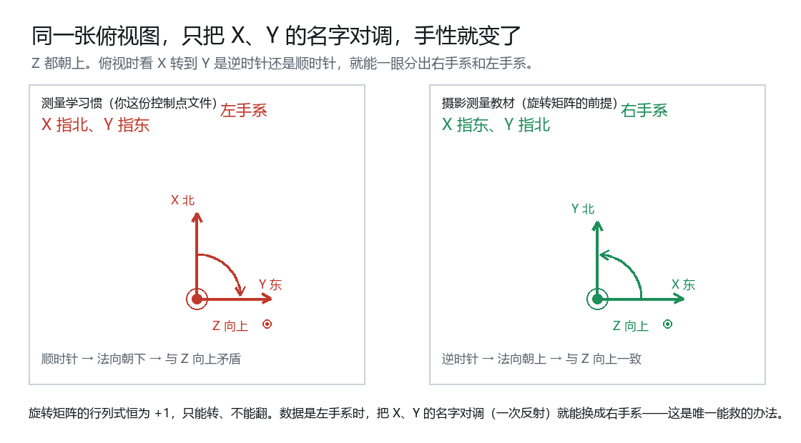

# 为什么第一次解出来的外方位是错的

## 0 三句话

1. **现象**：第一次点「解算」，程序报了成功，但 $Z_S=-1592.5$ m——相机跑到地面以下，$\varphi=177°$，$\sigma_0=2.96$ mm，相当于 66 个像元。
2. **原因**：你那份控制点文件是**左手系**（$X$ 指北、$Y$ 指东），程序按右手系（$X$ 指东、$Y$ 指北）去解。旋转矩阵只能转、不能翻，所以**任何**姿态都对不上。
3. **现在**：轴序自动判定之后，$Z_S=3230.7$ m，$\sigma_0=0.0285$ mm（0.63 个像元），9 个点全部通过检核。

中间其实有**两个**独立的错：

| # | 错在哪 | 性质 | 后果 |
|---|---|---|---|
| 1 | 地面坐标轴序 | 模型假设错 | $\sigma_0$ 大到 66 像元，解出倒置解 |
| 2 | `1156` 的刺点 | 数据错 | $\sigma_0$ 卡在 0.27 mm 下不去，剔掉它掉到 0.027 mm |

第 1 个是你猜的方向——「算法出了问题」；第 2 个不是算法问题。下面从头讲。

---

## 1 先把最后那张表读懂

### 1.1 你这次的结果

```
影像 01-156_50mic　后方交会　多余观测 12　σ₀ = 0.0285 mm　条件数 111
外方位　Xs = 14922.100 m　Ys = 11533.382 m　Zs = 3230.688 m
　　　　φ = -0.032949°　ω = -0.139538°　κ = -0.129731°
```

底下那张逐点残差表：

| 点号 | $V_x$ (mm) | $V_y$ (mm) | $\lvert V\rvert$ (mm) | $\lvert V\rvert/\sigma_0$ |
|---:|---:|---:|---:|---:|
| 1155 | −0.0150 | +0.0013 | 0.0151 | 0.53 |
| 1156 | +0.0307 | +0.0334 | 0.0454 | 1.59 |
| 1157 | +0.0086 | −0.0144 | 0.0168 | 0.59 |
| 2155 | +0.0011 | −0.0173 | 0.0173 | 0.61 |
| 2156 | −0.0307 | −0.0488 | 0.0577 | 2.03 |
| 2157 | +0.0032 | +0.0037 | 0.0049 | 0.17 |
| 6155 | +0.0173 | +0.0418 | 0.0452 | 1.59 |
| 6156 | +0.0146 | −0.0153 | 0.0211 | 0.74 |
| 6157 | −0.0245 | +0.0200 | 0.0316 | 1.11 |

这五列每列都在回答一个具体问题。先把三个基础名词摆清楚。

### 1.2 观测值、计算值、残差

| 名词 | 是什么 | 这张表里的位置 |
|---|---|---|
| **观测值** | 你在影像上刺出来的像点坐标 | 像平面坐标 $x_m,y_m$（不是直接显示的） |
| **计算值** | 用解出来的外方位，把控制点投影到像平面上算出来的坐标 | 不显示 |
| **残差** | 计算值 $-$ 观测值 | $V_x,V_y$ |

所以残差回答的是：**「如果这 6 个外方位是对的，这个控制点应该落在哪，跟它实际落在哪，差多少」**。

残差大的可能有两种：外方位不对，或者这个点刺错了。区分这两件事，是第 8 节的全部内容。

### 1.3 $V_x$、$V_y$：两个方向的差

单位是**毫米**，不是像元。$V_x$ 是像平面 $x$ 方向（大致左右）的差，$V_y$ 是 $y$ 方向（大致上下）的差，都带正负号。

你这张 $01\text{-}156$ 的像元尺寸 $\delta=0.045025$ mm，所以

$$\text{像元数}=\frac{\text{毫米数}}{0.045025}$$

比如 `2156` 的 $V_y=-0.0488$ mm，就是 $-1.08$ 个像元——按解出来的外方位，它该落的位置比你刺的位置**低**一个像元。

### 1.4 $|V|$：这个点总共偏了多少

$$|V|=\sqrt{V_x^2+V_y^2}$$

是残差的长度，不分方向。`2156` 是 $\sqrt{0.0307^2+0.0488^2}=0.0577$ mm $=1.28$ 个像元。

**这是最直观的一列**：一个点离它该在的位置有多远。

### 1.5 $|V|/\sigma_0$：拿「这一批的一般水平」作尺子

$\sigma_0$ 是这批观测的一般精度水平（下一节），把 $|V|$ 除以它，就得到**「这个点比一般水平离谱多少倍」**。

$$\frac{|V|}{\sigma_0}=\frac{0.0577}{0.0285}=2.03$$

为什么需要这一列：残差的绝对大小跟比例尺、刺点习惯都有关，同样是 0.05 mm，在一批 0.01 mm 的数据里是灾难，在 0.1 mm 的数据里很正常。除掉 $\sigma_0$ 之后，剩下的才是「相对其他点有多离群」。

程序在 $|V|/\sigma_0>3$ 时标「← 偏大」。这个 3 是**经验门槛，不是严格检验**：

- 严格做法（数据探测法）用 $\dfrac{|V|}{\sigma_0\sqrt{1-h_{ii}}}$，其中 $h_{ii}$ 是该点在 $\mathbf{H}=\mathbf{A}\mathbf{N}^{-1}\mathbf{A}^\top$ 上的对角元，$0<h_{ii}<1$。因为 $1-h_{ii}<1$，所以现在这一列是**低估**的，门槛 3 偏松。
- 更要紧的是 $\sigma_0$ 本身会被粗差抬高：一个有粗差的点，会同时增大自己的 $|V|$ 和整体的 $\sigma_0$，比值反而被压住。

  上一轮那张表里，`1156` 的比值正好 **3.07**，压着线被标了出来——可它当时是真的点错了 23 个像元。门槛能提示「去看一眼」，定案还得靠别的。

所以这一列只当「第一眼筛选」，真正的判决要靠第 8 节的逐点剔除。

### 1.6 $\sigma_0$：单位权中误差

$$\sigma_0=\sqrt{\frac{\mathbf{V}^\top\mathbf{V}}{2n-6}}$$

**分子**：所有残差平方和 $\mathbf{V}^\top\mathbf{V}$。你的数据是 $0.00971\ \text{mm}^2$。

**分母**：$2n-6$ 叫**多余观测数**（下一节）。$n=9$ 个控制点，每个点给两个方程，未知数 6 个，所以 $18-6=12$。

$$\sigma_0=\sqrt{\frac{0.00971}{12}}=0.0285\ \text{mm}$$

四个必须知道的性质：

**① 单位是毫米，不是像元。**「中误差 0.0285」单看没有意义，要换成 $\sigma_0/\delta=0.0285/0.045025=0.63$ 个像元。手工刺点一般 0.5–1 个像元，0.63 正常。

**② 它比残差的平均大小略大。** 你的残差平方和除以 18 是 $0.0233$ mm（每坐标的均方根），除以 12 是 $0.0285$ mm。差 $\sqrt{18/12}=1.22$ 倍。为什么除小的那个：因为 18 个残差里有 6 个被「解方程」这个动作消耗掉了（6 个未知数总能让自己那部分残差为 0），只有 12 个是**真正多余出来的检核**。用多余的个数去除，才是无偏估计。

**③ 它衡量的是一致性，不是真误差。** 如果 9 个控制点同时按某个规律错（比如控制点本身是同一套旧坐标），$\sigma_0$ 完全看不出来。所以 $\sigma_0$ 小只说明「这批数据内部自洽」，不说明「绝对正确」。

**④ 它是后面所有中误差的乘数。** 结果里的

$$m_{X_S}=\sigma_0\sqrt{(\mathbf{N}^{-1})_{11}},\quad m_{Z_S}=\sigma_0\sqrt{(\mathbf{N}^{-1})_{33}},\quad\dots$$

全都是 $\sigma_0$ 乘一个只跟几何有关的系数。$\sigma_0$ 错了，所有精度指标一起错。

### 1.7 多余观测 12

$$\text{多余观测}=2n-6$$

| 控制点个数 | 方程数 | 多余观测 | 能干什么 |
|---:|---:|---:|---|
| 3 | 6 | **0** | 残差恒为 0，$\sigma_0$ 分母为 0，无任何检核 |
| 4 | 8 | 2 | 能算 $\sigma_0$，勉强能发现大粗差 |
| 9 | 18 | **12** | 有余量做逐点剔除、做粗差定位 |

这就是「后方交会至少要 4 个控制点」的全部理由：不是方程不够，是**一个多余观测都没有的时候，解出来的东西无法检验**。

多余的观测越多，「敢下结论」的底气越足。你的 12 个，够剔掉一个点再看结果。

### 1.8 条件数 111

条件数衡量「这个几何构型有多难解」。粗略地说：

$$\kappa=\frac{\text{最敏感方向的放大率}}{\text{最不敏感方向的放大率}}$$

**为什么要先做列平衡**：法方程里同时混着米（$X_S$）、毫米（偏导）、弧度（角度）三种量纲，直接算条件数会到 $10^6$，那个数只反映单位没统一，不含信息。程序先把每一列按范数归一化，再算，得到 111。

**111 意味着什么**：最坏方向上，观测的 1% 相对误差可以被放大到 111%（这是悲观上界，实际通常远好）；协方差椭球的长短轴比约 $\sqrt{111}\approx10.5$。

**经验判据**：$<1000$ 好，$10^3\sim10^4$ 要查控制点分布，$>10^4$ 基本无解。你这 111 很强——9 个点在 2.3 km × 2.8 km 的范围内铺开，航高 2.4 km，几何相当结实。

### 1.9 一句话读表

> 9 个点，多余观测 12，$\sigma_0=0.63$ 像元（手工刺点该有的水平），最不顺眼的点偏了 2 倍 $\sigma_0$，几何强度 111。**解对了。**

---

## 2 出问题的那一次

### 2.1 当时的结果

```
东-北-天（X 指东、Y 指北）
  Zs = -1592.5 m    φ = 177.16°    κ = 90.03°    σ₀ = 2.9617 mm（65.8 个像元）
```

当时这一版还没有闸门，所以它被当成「成功」报了出来。现在拿同样的数据重跑，它是这样被拒的：

```
东-北-天（X 指东、Y 指北）   拒收
  理由：解算结果不可信：σ₀ = 2.9617 mm，相当于 65.8 个像元（限 10 个）。
        模型解释不了量测值，先查刺点有没有点错、控制点是否属于这张影像、单位对不对。
```

### 2.2 三个数字都在喊「不对」

| 数字 | 正常应该 | 当时 | 说明什么 |
|---|---|---|---|
| $Z_S$ | 高于地面（你这片约 834 m） | $-1592$ m | 相机在地面以下 2.4 km |
| $\varphi$ | 接近 $0°$ | $177°$ | 相机倒过来，朝上拍 |
| $\sigma_0$ | 0.5–1 个像元 | 66 个像元 | 模型根本解释不了量测值 |

三个数字是同一件事的三种表现：**解出来的姿态是「相机翻到地下、朝上拍」**——因为只有这样才能让镜像的地面点和像点勉强凑在一起。

航摄不存在这种姿态。所以它是错的，不需要任何专业知识就能看出来——只要你知道「航高应该是 2.4 km、相机朝下」。

### 2.3 「程序说成功」为什么不算数

第一版程序只判一条：**「最后一步的改正数够小，就宣布成功」**。那条判据只说明迭代停了，不说明停对了地方。

修法不是改算法，是**加检核**：算完了必须再过几道几何和统计的门（第 7 节）。这就是为什么现在同样的数据会直接报「拒收」而不是报「成功」。

---

## 3 最小二乘为什么总会给你一个答案

这一段解释「为什么错了还能算出一个像模像样的结果」。

### 3.1 它只负责「最不坏」

最小二乘的目标只有一个：

$$\min\ \mathbf{V}^\top\mathbf{V}=\min\sum_i\left(\text{计算值}_i-\text{观测值}_i\right)^2$$

它不问「模型对不对」，只问「在这 6 个参数的所有取值里，哪一组让平方和最小」。

**只要法方程 $\mathbf{N}=\mathbf{A}^\top\mathbf{A}$ 可逆，它就一定给你一组数**，哪怕这组数在物理上荒谬。控制点不少于 3 个、分布不退化，$\mathbf{N}$ 就可逆。

### 3.2 收敛有两种

| | 收敛到真值 | 收敛到「假谷底」 |
|---|---|---|
| 残差 | 掉到噪声水平 | 停在一个比较大的值不再下降 |
| 参数 | 合理 | 可能荒谬，也可能看着合理 |
| 怎么区分 | 要和别的检查对照 | **只能靠外部检核** |

你的那次属于第二种：残差平方和确实在下降，但下限是 $(66\ \text{像元})^2$ 量级，不是 $(0.6\ \text{像元})^2$。因为它要拟合的东西**根本不在模型能表达的范围里**（下一节）。

### 3.3 于是必须另设检核

数学给不出「这个解对不对」，只能给「这组数让残差多小」。所以程序里必须写死一批**跟数学无关的常识**：

- $\sigma_0$ 不能超过像元尺寸的 10 倍（VL-10）——因为手工刺点不可能差 10 个像元；
- 摄影中心的 $Z$ 必须高于控制点平均高程（VL-11）——因为没有航摄是从地底下往上拍的。

这两条跟最小二乘一点关系都没有，纯粹是「摄影测量这件事的常识」。**算法越自动，这种常识越要写成代码。**

---

## 4 名词：坐标系、手性、行列式

这是整件事的核心。慢慢来。

### 4.1 一套坐标系由什么决定

三个问题：**原点在哪、三根轴朝哪、单位是什么**。

只要三根轴的方向定了，「$X$ 指北还是指东」这种问题就定了。这不是数学，是**约定**——大家事先说好用哪种。

问题在于：**不同行业说好了不同的约定。**

### 4.2 这个程序里有四套坐标

| # | 名字 | 单位 | 原点 | $y$ 朝哪 |
|---|---|---|---|---|
| 1 | 屏幕像素 `ScreenPointPx` | 像素 | 窗口左上角 | 朝**下** |
| 2 | 影像像素 `ImagePixel` | 像素 | 影像左上角 | 朝**下**（行列号 $I,J$） |
| 3 | 像平面 `ImagePointMm` | 毫米 | **主点** | **朝上** |
| 4 | 地面 `GroundPointM` | 米 | 测区 | 平面上：见下 |

前 3 套只在像方，跟这次的问题无关（所以内定向一直是对的，见第 6 节）。出事的是第 4 套。

### 4.3 右手的那个动作

伸出**右手**：食指指 $X$，中指指 $Y$，拇指自然指向 $Z$。三个方向满足这个关系，就叫**右手系**。

反过来，必须用左手才能摆出来的，叫**左手系**。

现在做一次实验。俯视地面，$Z$ 朝上（朝你）：

| 约定 | $X$ | $Y$ | $Z$（右手定则） | 结论 |
|---|---|---|---|---|
| 摄影测量教材 | 东 | 北 | 向上 ✔ | **右手系** |
| 国内测量学 | 北 | 东 | **向下 ✘** | **左手系** |

同一张俯视图，只把 $X$、$Y$ 的**名字**对调，手性就变了。这就是全部的秘密。



一个更快的判法：**俯视时，从 $X$ 转到 $Y$ 是逆时针就是右手系，顺时针就是左手系。**

### 4.4 你这份数据用的是左手系

`gxyz.rtf` 来自武汉大学遥感院，是国内测量学的写法：$X$ 指北、$Y$ 指东。

而摄影测量的共线条件方程（第 4.7 节）默认 $X$ 指东、$Y$ 指北。

所以：**把文件里的 $(X,Y)$ 直接代进公式，等于把地面点整体翻了一次面。**

具体表现：点在平面上的**转向**全都反了。原来按「北 → 东 → 南」顺时针排的三个点，现在读出来是逆时针——不是转了个角度，是**镜子里的样子**。数值一个都没变，变的只是「哪个叫北、哪个叫东」。

### 4.5 行列式：放大率，带正负号

一个 $2\times2$ 矩阵 $\begin{bmatrix}a&b\\c&d\end{bmatrix}$ 的行列式是

$$\det=ad-bc$$

几何意义：把这个矩阵作用在一片图形上，**面积放大了多少倍**；**正负号表示有没有翻面**。

- $\det>0$：形状被拉伸、旋转，但没翻面（顺时针还是顺时针）。
- $\det<0$：翻面了，顺时针变逆时针（镜子）。

$3\times3$ 也一样：$\det$ 是体积放大率，符号表示手性有没有变。

### 4.6 旋转矩阵的行列式一定是 $+1$

这不是巧合，是定义的直接推论。

旋转矩阵满足 $\mathbf{R}^\top\mathbf{R}=\mathbf{I}$（转动不改变长度）。两边取行列式：

$$\det(\mathbf{R}^\top\mathbf{R})=\det(\mathbf{R})^2=\det(\mathbf{I})=1$$

$$\Rightarrow\ \det(\mathbf{R})=\pm1$$

两个分支：$+1$ 是**旋转**，$-1$ 是**镜像**。摄影测量里用的 $\mathbf{R}$（第 4.7 节那个 $R_\kappa R_\omega R_\varphi$）永远在 $+1$ 那一支。它连一个 $-1$ 都取不到，因为它是由三个初等旋转阵乘出来的，而每个初等旋转阵的行列式都是 $+1$：

$$\det(\mathbf{A}\mathbf{B})=\det(\mathbf{A})\det(\mathbf{B})$$

所以

> **旋转矩阵永远表达不出镜像。** 给它的数据是镜像的，它就只能找一个「最不坏」的旋转，残差大到离谱也照给。

这就是那 66 个像元的来历。

### 4.7 共线条件方程长什么样

$$\begin{bmatrix}U\\V\\W\end{bmatrix}=\mathbf{R}\begin{bmatrix}X-X_S\\Y-Y_S\\Z-Z_S\end{bmatrix},\qquad
x_m=-f\frac{U}{W},\qquad y_m=-f\frac{V}{W}$$

$$R=R_\kappa R_\omega R_\varphi$$

读法：地面点相对摄影中心的位移，先被 $\mathbf{R}$ 转到像空间，再按「越远成像越小」除一下 $W$，最后乘 $-f$（主距）得到像平面坐标。

**关键在第一步**：$\mathbf{R}$ 是个纯旋转。它能把 (北,东) 转到任何方向，但**不能把左手系的地面点变成右手系的**。

于是——

> 无论 $\mathbf{R}$ 怎么调、$X_S,Y_S,Z_S$ 怎么挪，这 9 个点的镜像关系都消不掉。最小二乘找不到一个真正合适的解，只能给你一个残差最小的驻点。

---

## 5 是怎么查出来的

先讲顺序，再讲公式。

### 5.1 顺序：先数据、再初值、再模型

出问题的时候，可能的错按发生概率排：

1. **刺点错了**（最常见）；
2. **初值不好**，迭代掉进局部极小；
3. **模型假设错**（最少见，但一旦错了，前两条怎么查都查不出来）。

我先按 1→2 查了几轮（换初值、加倒置解判据、加验收闸门），残差一直是 66 个像元——**一点没动**。到这一步才能断定：错的是第 3 类。

「加了闸门残差也没变」这件事本身是重要信息：闸门只改变「要不要接受这个结果」，不改变「能算出什么」。残差不降，说明模型里少了一样东西。

所以正确的排查顺序是**先查便宜的**，但要有耐心：便宜的三条都排除干净了，才去动模型。

### 5.2 关键一步：降到二维，只看「转向」

6 个未知数的解算很难看清发生了什么。但有一个更弱、也更好看的问题：

> **先不管姿态，只看地面点的相对位置和像点的相对位置，形状对不对得上。**

最省事的一种问法：**取三个点，看它们转的方向。**

三个点连成两条有向边，二维叉乘就是**有向面积的两倍**：

$$S=\begin{vmatrix}x_2-x_1&x_3-x_1\\y_2-y_1&y_3-y_1\end{vmatrix}
=(x_2-x_1)(y_3-y_1)-(y_2-y_1)(x_3-x_1)$$

$S>0$ 是逆时针，$S<0$ 是顺时针。地面上同样算一个 $S_{\text{地}}$。

因为 $2S/(|\mathbf u||\mathbf v|)$ 是夹角的正弦，无量纲，所以**像平面的毫米和地面的米可以直接比**。

### 5.3 判据：两个符号

任何一个线性映射 $\mathbf M$ 作用在有向面积上，规律是

$$S'=\det(\mathbf M)\,S$$

所以「符号相同」⇔ $\det>0$ ⇔ **保向**；「符号相反」⇔ $\det<0$ ⇔ **翻面**。

而旋转加缩放 $\mathbf M=s\mathbf R$ 的 $\det=s^2>0$，恒保向。于是：

| | 正常（右手系数据） | 轴序反了 |
|---|---|---|
| 地面 $S$ 与像点 $S$ | **同号** | **异号** |
| 与 $\kappa$ 多大有关吗 | 无关 | 无关 |
| 与比例尺、航高有关吗 | 无关 | 无关 |
| 与 $Z$ 值有关吗 | 无关 | 无关 |
| 与像片倾角有关吗 | 无关 | 无关 |

前四行来自 $\det(s\mathbf R)>0$。第五行是因为加上 $Z$ 之后，像点坐标只是 $(X,Y)$ 的有理函数（多一个除以 $W$），它的雅可比在像片前方**恒为正**——$Z$ 只改变各点的缩放和偏移，是连续变形，翻不了符号。

所以**只需三个点、不用解算、不用迭代、能手算**，就能判出地面坐标该不该换轴。

**唯一要求：三点不能近共线。** 三角形越扁，叉乘越小，符号越容易被取点噪声翻掉。程序取所有三点组合里**最不共线**的那一组（$\min(|\sin\theta_{\text{像}}|,|\sin\theta_{\text{地}}|)$ 最大），并要求它 $>0.3$（夹角约 17°）。

### 5.4 用你的数据跑

```powershell
dotnet run --project src/Snap/Snap.csproj -c Debug -- --probe --project Data/real/Real_test.pht
```

```
手性判定 北-东-天（X 指北、Y 指东）
  三点 1157-1155-6157：像平面 sin = -0.999，地面 sin = +1.000，68/68 组三角形一致
  地面 (X,Y) 与像平面 (x,y) 绕向相反：文件是左手系（X 北、Y 东），已换轴。
  [PASS] 反证：按 东-北-天（X 指东、Y 指北）解 → 拒收（Zs=-1592.4 m，σ₀=2.9380 mm）
```

三句读法：

- **主判据**：最不共线的那组三点，像平面 $\sin=-0.999$、地面 $\sin=+1.000$，**异号** → 左手系。
- **旁证**：9 个点共 84 组三角形，去掉太扁的剩 68 组，**68 组全部同意**。没有任何一个三角形翻供。
- **反证**：不换轴硬解，被 VL-10 挡掉。这说明换轴这一步不是可选项。
  （这里的 σ₀ 是 2.9380 而不是 §2.1 的 2.9617，因为那时 `1156` 还没重刺。）

### 5.5 顺便还能看出比例尺和航高

同一批数据再做一次四参数相似拟合（用上全部点），能多拿一个数与上面互相印证：

```
东-北-天（X 指东、Y 指北）   det= -0.00400  相似残差  97.6%  镜像
北-东-天（X 指北、Y 指东）   det= +0.00400  相似残差   2.6%  成立
  比例尺 m = 0.06332 mm/m → 估算航高 H = f/m = 2412 m
```

$\det$ 的符号与三点判据一致（一个是全点投票，一个是三点定案），相似残差 97.6% ↔ 2.6% 相差 37 倍，也指向同一个结论。

比例尺本身就是航高的倒数：

$$m=\frac{f}{H}\ \Longrightarrow\ H=\frac{f}{m}=\frac{152.72\ \text{mm}}{0.06332\ \text{mm/m}}=2412\ \text{m}$$

而三维解出来 $Z_S=3230.7$ m、9 个点平均高程 $834.4$ m，航高 $2396.3$ m。两者差 **0.7%**——二维近似忽略了像片倾角和地形起伏，这个量级的偏差是正常的。

**这就是交叉验证的意义**：判手性只用 3 个点，算航高用了 9 个点 + 4 个参数，最后解出的航高又来自 6 个参数的非线性迭代。三条独立的路指向同一批数字。

顺带读出地面分辨率：

$$\text{地面分辨率}={\delta}\cdot\frac{H}{f}=0.045025\ \text{mm}\times15691=0.71\ \text{m}/\text{像元}$$

### 5.6 为什么这个检查这么管用

因为它**绕开了「姿态」这个变量**。

6 个参数可以被乱调去凑个别点，所以「残差小」不一定说明对。而「三个点转的方向」里一个姿态参数都没有——它不给你任何掩盖系统性错误的余地。

一般规律：**要检验一个复杂模型，先把它砍到一个没有余地的简化版本。**

而且这个简化版还满足一条更难得的要求：**能手算**。拿三对坐标、两个叉乘、比一下正负号，答案就出来了，不需要相信程序。

---

## 6 为什么之前一直没发现

这个错误藏了很久，值得说清楚，因为这是自检设计的问题。

### 6.1 内定向根本不碰地面坐标

内定向做的事：把像素 $(I,J)$ 换算成像平面 $(x_m,y_m)$，求 $\delta,x_0,y_0$。全程在**像方**，地面坐标一个都没用上。

所以内定向做得再对，也测不到地面轴序的错。你的内定向（$\delta=0.045025$、$x_0=-1.3775$、$y_0=+0.1618$）是对的，这跟后方交会的错没有关系。

### 6.2 合成数据是我按自己的假设造的

`Data/sim/` 里的控制点是我写的，写的时候脑子里就是「$X$ 指东、$Y$ 指北」。用它检验，等于自己出题自己判卷——**测不出模型的假设错**。

同理，**往返检验**（用已知外方位正投影生成像点，再反解）也测不出来：正投影和反解用的是同一个 $R$、同一套轴序，错的地方互相抵消。

### 6.3 教训

| 自检类型 | 能查出什么 | 查不出什么 |
|---|---|---|
| 往返检验 | 公式写错、符号错 | **模型假设错** |
| 合成数据 | 数值实现错 | **输入约定错** |
| 与教材对表 | 旋转矩阵元素错 | 轴序错 |
| 真实外部数据 | **上面全部** | 需要有人提供 |

结论：**自检里必须至少有一个「来源不受自己控制」的数据集。** `gxyz.rtf` 是别人测的、别人给的，一进来就把问题暴露了。

另外，检查不能只查「算得对不对」，还要查「**假设成不成立**」——$\det$ 的符号就属于后者。

---

## 7 修法

### 7.1 先判手性，换轴，再解一次

```
三点有向面积 → 异号 → 地面坐标换轴（X↔Y）
                        ↓
                   解算一次 → 过闸门 → 采用
```

不给用户选择，也不靠「解两次、谁残差小取谁」——**手性在解算之前就定了**，解算只做一次，几毫秒。

判定依据写进结果，能复核：

```
手性判定 北-东-天（X 指北、Y 指东）
  三点 1157-1155-6157：像平面 sin = -0.999，地面 sin = +1.000，68/68 组三角形一致
```

这一步在**托管层**做（`DetectGroundOrder`）。判轴序是数据适配，不是平差：DLL 只接受已经换好的右手系，共线方程里不该出现 `if (mirrored) swap(x, y)` 这种分支。边界见[界面设计规范 §8.1](界面设计规范.md)。

### 7.2 三道闸门

| 编号 | 判据 | 拦住的是 |
|---|---|---|
| VL-10 | $\sigma_0\le10\delta$ | 模型解释不了量测值（刺点、单位、轴序判错） |
| VL-11 | $Z_S>$ 控制点平均高程 | 倒置解（相机在地下） |
| VL-12 | 三点有向面积判手性，异号即换轴 | 轴序约定 |

再加一条不编号的：**迭代到上限仍未收敛，一律拒收**，不许当成成功。

为什么判完手性还要留着 VL-10：三点判据只用三个点，**没有冗余**。万一那三个点里有一个刺错了 30 个像元，符号可能就翻了，换轴也就换反了。这时候解算会给出 60 多个像元的 σ₀，VL-10 一把挡住。所以顺序是「先判、后解、再闸」——判定负责给对方向，闸门负责兜底。

### 7.3 为什么不给你一个下拉框

技术上可以做，但那样等于**把判断责任推给作业员**，而且要求他懂测量学和摄影测量两套约定——这正是最难的一环。

判手性的成本极低：84 个三角形、几百次乘加，连一毫秒都用不上，而且**结果有唯一性**——符号就在那里，不需要人参与。

只有一种情况会判不出来：控制点在影像上挤成一条线，三角形都太扁。这时候报错，让人重新选点或检查刺点。

---

## 8 第二个错：`1156` 刺偏了

### 8.1 轴序修好之后，$\sigma_0$ 还是下不去

轴序改成北-东-天，$\sigma_0$ 从 2.96 mm 掉到 **0.2708 mm**（6 个像元）——好了 10 倍，但还不够。

如果只看到这里就收工，会得出「这数据精度一般」的错误结论。

### 8.2 逐点剔除

做法：**每次去掉一个点，重新解一遍，看 $\sigma_0$ 掉多少。**

那时（`1156` 还没重刺）的结果：

| 去掉谁 | $\sigma_0$ | 相对 |
|---|---:|---:|
| （不去） | 0.2708 mm | 100% |
| **1156** | **0.0267** | **10%** ← |
| 1155 | 0.2781 | 103% |
| 1157 | 0.2861 | 106% |
| 2156 | 0.2873 | 106% |
| 2155 | 0.2922 | 108% |
| 6156 | 0.2932 | 108% |
| 2157 | 0.2939 | 109% |
| 6157 | 0.2963 | 109% |
| 6155 | 0.2964 | 109% |

去掉 `1156`，$\sigma_0$ 掉到**十分之一**：0.0267 mm，0.6 个像元。这就是「把那个错的点拿掉之后，剩下 8 个点是自洽的」——说明错的只有它一个，而且错得很厉害。

（表里除了 `1156`，其余全在 100%–109% 之间晃：去掉任何正常点，剩下的点要把它的误差摊掉，$\sigma_0$ 反而略微变大。100% 上下浮动是正常现象。）

### 8.3 那个点应该在哪

用其余 8 个点定出的姿态反算 `1156` 的位置：**像元 (2549, 1242)**。

你刺在 **(2569, 1254)**，差 23 个像元（1.05 mm）。

放大看：点在土路交叉口上了，真正的圆形测标在左上方一点。这张影像的地面分辨率是 0.71 m/像元，23 个像元 ≈ **16 米**——从土路口挪到测标上，就是这么点距离。

### 8.4 重刺之后

现在是 $|V|=0.0454$ mm、$|V|/\sigma_0=1.59$，落在正常散布里。$\sigma_0=0.0285$ mm（0.63 像元）。

比「去掉它」时的 0.0267 mm 略大，这是正常的：那个 0.0267 是 8 个点的自洽度，现在把第 9 个点加回来，它带回了一点点偏差，但已经不影响结论。

### 8.5 现在的 `2156` 要不要管

它 $|V|/\sigma_0=2.03$，是表里最大的。但：

- 1.3 个像元（0.0577 mm），手工刺点的正常散布；
- 逐点剔除去掉它只掉到 80%，远没到「掉一半」；
- 反算位置跟你刺的位置差 2 个像元。

所以它是**精度最差的点**，不是错的点。没有理由动它。

**判据不是「谁最大」，是「拿掉谁之后整体水平塌下来」。**

---

## 9 现在的结果算不算对

### 9.1 五条判据

| # | 判据 | 为什么 |
|---|---|---|
| 1 | $\sigma_0$ 与刺点精度相称 | 手工刺点 0.5–1 像元，$\sigma_0$ 就该在这个量级 |
| 2 | 航高与比例尺相符 | 两条独立的路给出同一个 $H$ |
| 3 | 三个角接近 0 | 航摄是近竖直摄影 |
| 4 | 条件数不大 | 控制点分布够好 |
| 5 | 残差无趋势、无大值 | 没有剩余的系统误差 |

### 9.2 逐条过你的数据

| # | 你的数 | 判断 |
|---|---|---|
| 1 | $\sigma_0=0.0285$ mm $=0.63$ 像元 | ✔ 正常 |
| 2 | 三维 $H=2396$ m，二维 $H=2412$ m，差 0.7% | ✔ 一致 |
| 3 | $\varphi=-0.033°$、$\omega=-0.140°$、$\kappa=-0.130°$ | ✔ 都在 0.15° 内 |
| 4 | 条件数 111 | ✔ 很强 |
| 5 | 最大 $\lvert V\rvert/\sigma_0=2.03$，剔除不掉队 | ✔ 无粗差 |

结论：**这一步可以过了。**

### 9.3 但它还不能说明什么

诚实一点，$\sigma_0$ 小只证明「内部一致」。以下都不在其中：

- **绝对精度**：9 个控制点如果本身有共同的系统偏差，$\sigma_0$ 看不出来。$m_{X_S}$ 之类的中误差是「按 $\sigma_0$ 外推」的，不是真误差。
- **镜头畸变**：内定向只做了六参数仿射，畸变没有模型。畸变会以系统方式进入外方位，$\sigma_0$ 吸收不了。
- **高程方向的强度**：这批点高程 703–1016 m，高差 313 m，而平面范围 2.3 km × 2.8 km。高程对姿态的约束本来就弱。
- **它是斜距**：结果里的「平均摄影距离 2790.7 m」是到控制点的平均斜距，不是航高。

这些是后面做前方交会时要小心的地方，不是现在要解决的问题。

---

## 10 下次解飞了，按这个顺序查

1. **看 $\sigma_0$ 换算成几个像元**。超过 10 个，先别信任何参数。
2. **看 $Z_S$ 是不是比地面高**。不合理就是倒置解。
3. **看三个角**。超过几度就说明姿态不对，航摄不会这样。
4. **跑逐点剔除**。谁让 $\sigma_0$ 塌下来，谁就是粗差。
5. **还查不出来，降到二维**：三点叉乘，两个 $S$ 同号还是异号——异号就是手性问题。
6. **看控制点是否属于这张影像**。`gxyz.rtf` 里 15 个点分属两张片，点错片子会得到「看起来还行」的结果。

---

## 11 名词表

| 名词 | 一句话解释 | 在哪出现 |
|---|---|---|
| **摄影中心 $S$** | 相机的投影中心，光线都从这里穿过 | 外方位前三个数 |
| **主距 $f$** | 摄影中心到像平面的距离 | 相机文件 |
| **主点** | 相机光轴与像平面的交点，像平面坐标的原点 | 内定向结果 |
| **像元 / 像元尺寸 $\delta$** | 影像上一个像素；它的物理边长（约 0.045 mm） | 换算全靠它 |
| **内定向** | 求「像素 ↔ 像平面毫米」的换算关系 | M2 |
| **外方位元素** | 相机的 6 个位置姿态参数 $X_S,Y_S,Z_S,\varphi,\omega,\kappa$ | 后方交会的结果 |
| **控制点** | 地面坐标已知、在影像上能找到的点 | `gxyz.rtf` |
| **刺点** | 在影像上把控制点的位置点出来 | M3 |
| **共线条件方程** | 地面点、摄影中心、像点三点共线，写成公式就是它 | §4.7 |
| **观测值 / 计算值 / 残差** | 量出来的 / 用模型算出来的 / 两者的差 | §1.2 |
| **最小二乘** | 让残差平方和最小的求解方法 | §3.1 |
| **法方程** | 最小二乘化成线性方程组后的形式 $\mathbf{N}\Delta\mathbf{p}=\mathbf{u}$ | 内部 |
| **迭代** | 先猜初值算残差，再改正，反复直到不再变 | 4 次 |
| **收敛** | 改正数小到可以忽略；**不等于解对的** | §3.2 |
| **多余观测** | 方程数减未知数，$2n-6$，检核的本钱 | §1.7 |
| **单位权中误差 $\sigma_0$** | 这批观测的整体精度水平，残差平方和除以多余观测再开方 | §1.6 |
| **中误差 $m$** | 某个参数的标准差估计 | 结果里的 $m_{X_S}$ 等 |
| **条件数** | 几何构型的病态程度 | §1.8 |
| **粗差** | 不是随机噪声的错，刺错了、点号错了之类 | `1156` |
| **旋转矩阵 $\mathbf{R}$** | 把地面方向转到像空间的 $3\times3$ 矩阵，行列式恒为 $+1$ | §4.6 |
| **正交矩阵** | 满足 $\mathbf{A}^\top\mathbf{A}=\mathbf{I}$ 的矩阵，转动不改变长度 | 同上 |
| **行列式** | 矩阵的面积/体积放大率，符号表示有没有翻面 | §4.5 |
| **右手系 / 左手系** | 三个轴满足右手定则的坐标系 / 必须用左手的 | §4.3 |
| **镜像** | 翻面后的样子，行列式为负，旋转永远表达不出 | §4.6 |
| **相似变换** | 只有平移、旋转、等比缩放的变换，4 个参数 | §5.2 |
| **仿射变换** | 相似变换再允许各方向拉伸，8 个参数 | §5.3 |
| **倒置解** | 相机跑到地面以下、$\varphi\approx180°$ 的伪解 | §7.2 |
| **检核 / 闸门** | 算完之后用来判断「这个结果能不能信」的判据 | §7.2 |

---

## 附录 A 复现

```powershell
# 编算法 DLL
cmake --build native/build --config Release

# 算法自检（含「倒置解当初值仍能爬回真值」「单点粗差被拒」）
native\build\bin\Release\pgm_resection_test.exe

# 真实控制点：解析 + 封送 + 合成往返 + 粗差
dotnet run --project src/Snap/Snap.csproj -c Debug -- --control --gcp Data/real/2_Hammer/HammerIndex/gxyz.rtf

# 工程复核：手性判定、二维相似性、逐点剔除、粗差该点在哪
dotnet run --project src/Snap/Snap.csproj -c Debug -- --probe --project Data/real/Real_test.pht
```

本文所有数字都出自上面第三条命令的输出，可以直接比对。
