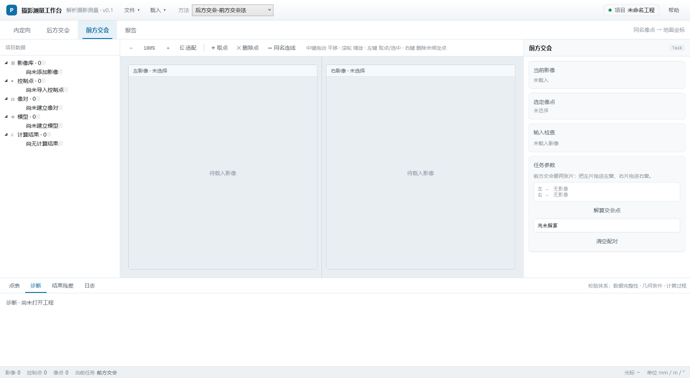
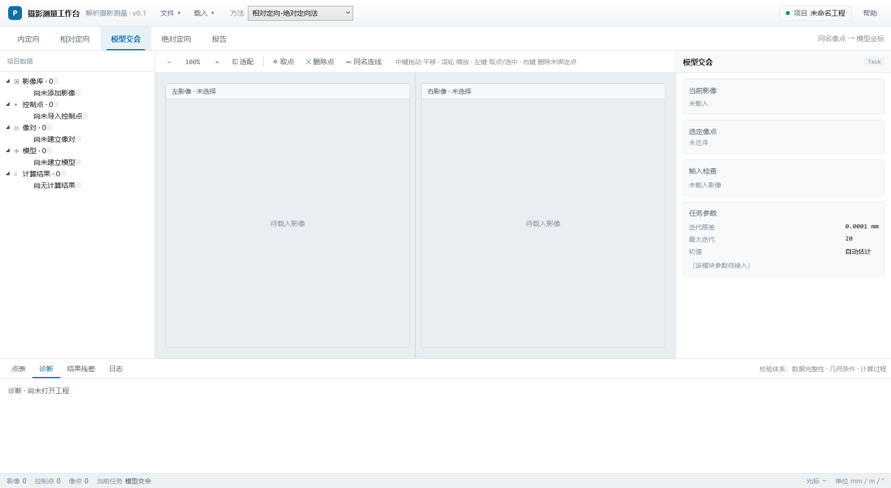
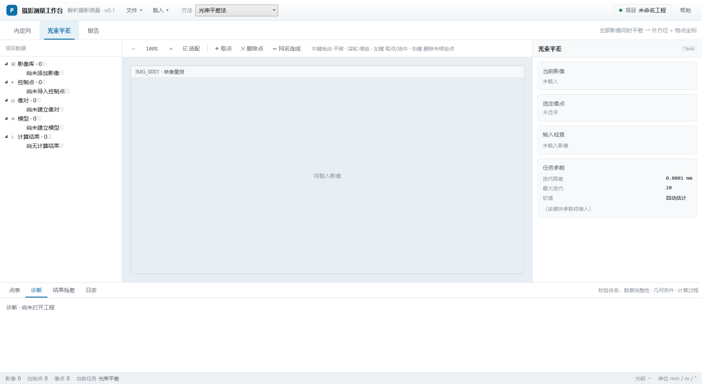

# 摄影测量工作台 · 界面设计规范

版本 1.1 ｜ 状态：定稿，作为实现依据
可交互原型：`Design/ui-prototype.html`（页面结构与本文一一对应）

> **进度不在本文维护。** 里程碑、完成状态、数据策略见[路线图](路线图.md)。本文只定义"应当是什么样"。

---

## 1 范围

**覆盖**：单像 / 双像工程的数据管理，内定向（参数式与框标仿射式）、后方交会、前方交会、相对定向、模型交会、绝对定向、报告输出、项目持久化。

**不覆盖**：自动特征提取与匹配、区域网平差、密集匹配、DEM / 正射影像生产。

**实现形态**：C# + WPF 桌面程序。平差计算由 C++ DLL 通过 C ABI 提供（MSVC 构建），数据适配与流程控制在托管层——边界见 8.1。

---

## 2 坐标与单位

### 2.1 四种坐标必须独立成类型

| 坐标 | 单位 | 原点 / 轴向 | 用途 |
|---|---|---|---|
| 屏幕坐标 | 设备像素 | 控件左上，y 向下 | 仅用于鼠标事件与命中判定 |
| 像素坐标 | px | 影像左上，y 向下 | 影像文件的原生索引 |
| 像平面坐标 | mm | 像主点，x 右 y 上 | 所有算法的输入 |
| 地面坐标 | m | 工程坐标系 | 控制点、交会结果、绝对定向输出 |

禁止使用同一个 `Point` / `Vector2` 类型承载多种坐标；类型名中必须带单位或坐标系标识（如 `ImagePointMm`、`ScreenPointPx`）。

### 2.2 单位与角度

- 像方长度一律 mm，地面长度一律 m，界面不做自动单位换算。
- 角度在界面显示为度（°，保留 4 位小数），传给算法前转弧度。
- 旋转角采用 φ-ω-κ 顺序，旋转矩阵构造方式在工程配置中固定一处，全局唯一，不得分模块各写一套。

### 2.3 像素 → 像平面换算

参数式（内参已知）：

$$x_m=\left(I-\frac{W}{2}\right)\delta-x_0,\qquad
y_m=-\left(J-\frac{H}{2}\right)\delta-y_0$$

有框标时用六参数仿射：

$$\begin{cases}
x_m=a_0+a_1I+a_2J\\[2pt]
y_m=b_0+b_1I+b_2J
\end{cases}$$

参数式是仿射式在 $a_2=0$、$b_1=0$、$a_1=\delta$、$b_2=-\delta$ 时的特例，所以程序里只需**一套**实现。推导与算例见[算法笔记 §5](算法笔记.md)。

换算**只允许有一份实现**（`CoordinateConverter` / `InteriorOrientation`），界面读数与算法输入都走它。

---

## 3 数据模型

### 3.1 实体

```
Project 工程
├── Camera[]         相机        内方位元素 + 框标坐标（多张影像可共用）
├── Image[]          影像        引用一个相机、外方位元素、框标观测
├── Gcp[]            控制点      工程级已知量
├── StereoPair[]     像对        相对定向元素的宿主
├── Model[]          模型        绝对定向的输入与输出
└── Result[]         计算结果    报告的唯一数据源
```

框标属于**相机**而不属于影像：同一台相机的 8 个框标坐标是固定的，每张影像只是各自量了一组像元坐标。把框标挂在影像上，会导致同一相机的标定数据重复 6 份、改一处漏五处。

`Image → StereoPair → Model` 是三级依赖，不可合并：像对既不属于左片也不属于右片；模型点由相对定向与模型空间前方交会产出，必须独立存储。

### 3.2 字段

| 实体 | 字段 | 类型 | 约束 |
|---|---|---|---|
| Image | Id | string | 唯一，取文件名主干 |
| | Path | string | 相对工程文件的相对路径 |
| | Width / Height | int | px，> 0 |
| | PixelSize | double | mm/px，> 0 |
| | FocalLength | double | mm，> 0 |
| | X0 / Y0 | double | mm，可正可负 |
| | ExtOri | ExteriorOrientation? | 未解算时为 null |
| | Status | enum | 未处理 / 已内定向 / 已定向 |
| | CameraId | string | 外键，指向 `Camera` |
| Camera | Id | string | 唯一，如 RC30 |
| | FocalLength | double | mm，> 0 |
| | Fiducial[] | Fiducial[] | 框标坐标表，可为空（无框标时只能做参数式） |
| Fiducial | Id | int | 唯一，如 1..8 |
| | X / Y | double | mm，像平面坐标，以像主点为原点 |
| | Type | enum | 角框标 / 边框标 |
| FiducialMark | ImageId | string | 外键 |
| | FiducialId | int | 外键，指向同一相机的框标 |
| | I / J | double | px，**允许小数**（亚像素） |
| | Residual | double? | mm，解算后回填 |
| Gcp | Id | string | 唯一，如 GCP01 |
| | X / Y / Z | double | m |
| | Type | enum | 平高 / 高程 / 检查点 |
| ImagePoint | ImageId | string | 外键 |
| | GcpId / TieId | string | 二选一，指认归属 |
| | X / Y | double | mm，像平面坐标 |
| | Residual | double? | mm，计算后回填 |
| TiePoint | Id | string | 唯一，如 P01 |
| | Observations | ImagePoint[] | ≥ 2 才可用于相对定向 |
| | Q | double? | mm，上下视差残差 |
| StereoPair | LeftId / RightId | string | 外键，不可相同 |
| | RelOri | RelativeOrientation? | 5 元素 |
| | PointIds | string[] | 参与解算的同名点 |
| Model | Id | string | 唯一 |
| | ModelPoints | Point3[] | 模型坐标系 |
| | AbsOri | AbsoluteOrientation? | 7 参数 |
| | GcpIds | string[] | 参与绝对定向的控制点 |
| Result | Task | string | 任务名 |
| | TimeUtc | datetime | 运行时刻 |
| | InputSummary | string | 输入摘要（点数、影像数） |
| | Params / Residuals | 结构化 | 供表格与报告渲染 |

### 3.3 约束

- 一个 `ImagePoint` 只能归属一个 `Gcp` 或一个 `TiePoint`。
- 同一 `Gcp` 在同一 `Image` 上最多一个像点。
- `Gcp.Type == 检查点` 的点不参与解算，仅在结果中输出不符值。
- 删除 `Image` 时，级联删除其全部 `ImagePoint` 与 `FiducialMark`，并从受影响的 `StereoPair` 中移除该像对。
- 同一 `Fiducial` 在同一 `Image` 上最多一个 `FiducialMark`。
- `FiducialMark` 少于 4 个时不得执行仿射内定向（VL-07）；3 个时方程数与未知数相等，残差恒为 0，无法检核。
- 删除 `Camera` 前必须确认没有 `Image` 引用它；框标修改后，引用该相机的影像内定向结果标记为失效。

---

## 4 界面结构

### 4.1 五区

```
┌─────────────────────────────────────────────────────────────────┐
│ 标题栏  [P] 名称 · 文件▾ · 载入▾ ……… 工程名 · 帮助              │
├─────────────────────────────────────────────────────────────────┤
│ 模块栏  [方法 ▾] 该方法的步骤序列（从左到右即执行顺序）         │
├──────────────┬──────────────────────────────┬───────────────────┤
│ 数据树       │ 影像工作区                   │ 检查器            │
│ 268 px       │ 自适应                       │ 372 px，可浮动    │
├──────────────┴──────────────────────────────┴───────────────────┤
│ 底部面板  点表 │ 诊断 │ 结果残差 │ 日志                         │
├─────────────────────────────────────────────────────────────────┤
│ 状态栏  计数 · 光标坐标 · 校验汇总 · 单位                       │
└─────────────────────────────────────────────────────────────────┘
```

实际渲染（`--module 前方交会`，离屏截图，1539×844）：



职责边界（违反即返工）：

| 区 | 职责 | 禁止 |
|---|---|---|
| 数据树 | 实体层级、当前选中 | 参数输入 |
| 工作区 | 影像显示、取点、连线、缩放平移 | 计算、结果展示 |
| 检查器 | 当前选中实体的属性、当前任务的参数与结果 | 数据树操作 |
| 底部 | 批量编辑、诊断、列表、日志 | 编辑影像 |
| 状态栏 | 计数与只读状态 | 任何按钮 |

### 4.2 中央工作区四态

| 态 | 用于 | 布局 |
|---|---|---|
| 单图 | 内定向、光束平差（暂定，形态未定） | 1 个视窗占满 |
| 刺点 | 后方交会 | 左 340 px 控制点放大影像（对照，不可点）+ 右整幅航摄影像（刺点），各自缩放 |
| 双图 | 前方交会、相对定向、模型交会 | 左右 1:1，同名点连线 |
| 模型 | 绝对定向 | 单视窗，透视地面网格 + 模型点 |
| 报告 | 报告 | 白纸预览，无交互 |

所有视窗的缩放与平移**各自独立**：每个视窗持有自己的 `(s, tx, ty)`，互不影响。工具栏的缩放/适配作用于鼠标所在的视窗（`ActiveView`）。

刺点形态的左窗只是**对照**：它不做命中判定、不产生像点。找不到放大影像时左窗显示一行提示，刺点照常进行——没有对照也不该挡住作业。

### 4.3 检查器

内容由**当前选中实体的类型**决定，不由当前模块决定。模块只决定"任务面板"那一栏。

| 选中 | 检查器显示 |
|---|---|
| 影像 | 内方位元素、外方位元素（若有）、状态 |
| 像对 | 相对定向元素、Q 中误差、像点列表 |
| 模型 | 七参数、控制点不符值、检查点偏差 |
| 控制点 | X/Y/Z、类型、各影像观测 |
| 同名点 | 各影像像点、残差、是否参与解算 |

检查器可停靠（默认右栏）或浮动（无边框窗口，非模态）。浮动后内容不变，仍只显示单个选中对象。

### 4.4 底部面板

| 页签 | 内容 | 默认高度 |
|---|---|---|
| 点表 | 当前任务要用到的点。内定向列框标（像平面坐标 / 方位 / 像元），后方交会列控制点（地面坐标 / 类型 / 像平面坐标 / 像素 / 残差）。选中一行即把该点设为"下一个要点的点" | 272 px |
| 诊断 | 三层校验结果 | 198 px |
| 结果残差 | 当前任务的逐点残差表 | 198 px |
| 日志 | 时间戳 + 级别 + 消息 | 198 px |

切到点表时面板自动加高，切回其他页签恢复原高度。

点表的列随模块切换，**不要**做成两张独立面板（ADR-16）。

点表本身只读，表头不放命令按钮。删除分两级，各归其位：

| 动作 | 位置 | 作用范围 |
|---|---|---|
| 删掉某一个点 | 点表里右键那一行 | 当前影像上的那一个框标 / 那一个刺点 |
| 清空本影像的点 | 模块面板（内定向「清空本影像框标」、后方交会「清空本影像刺点」） | 只清当前影像，别的片不动 |

同一件事在两个地方各有一个入口，作业员就不知道按哪个、也不知道按了作用在几张片上——M3 第一版在表头放过一对「清除」按钮，就是这个毛病，已删。

### 4.5 色彩与主题

界面为浅色主题：白底、深色字，强调色只用于可交互元素与状态，不做大面积填充。

| 用途 | 色值 |
|---|---|
| 窗口背景 | `#F4F6F8` |
| 面板 / 卡片 | `#FFFFFF` |
| 次级面板 | `#F7F9FA` |
| 分隔线 | `#E1E6EB`（细）/ `#C9D2D9`（粗） |
| 主要文字 | `#16191D` |
| 次要文字 | `#58636E` |
| 弱化文字 | `#8B959F` |
| 强调（选中、链接、当前页签） | `#0F6FA8` |
| 成功 / 警告 / 错误 | `#1E8E5A` / `#A86A12` / `#C0392B` |
| 工作区底色 | `#E9EEF3` |

### 4.6 窗口与缩放

- 主窗口启动即为最大化，`MinWidth 1100 / MinHeight 720`。
- 应用程序清单声明 Per-Monitor V2 DPI 感知，避免高缩放比例下窗口超出屏幕、标题栏按钮不可达。

---

### 4.7 影像库与工作区

这是两个不同的东西，必须分开：

| | 影像库 | 工作区 |
|---|---|---|
| 存在形式 | 数据树中的影像节点 | 视窗里显示的影像 |
| 数量 | 工程内全部影像，N 张 | 最多两张（双图） |
| 生命周期 | 随工程保存 | 随会话变化，不写盘 |
| 谁拥有数据 | `Project.Images` | 不拥有，只引用 |

操作规则：

| 操作 | 行为 |
|---|---|
| 双击影像行 | 载入到下一个可用视窗 |
| 拖拽影像行到视窗 | 载入到指定的那个视窗（左右各一） |
| 视窗标题栏 × | 从工作区移除（不删除数据） |
| 树上右键「从工作区移除」 | 同上 |
| 树上右键「载入到工作区」 | 同双击 |
| 树上右键「从工程移除…」 | 从工程索引中删除，**磁盘文件不动**；弹出确认 |

右键必须先选中光标下的节点，再弹菜单。WPF 的 `TreeView` 右键**不会**改变 `SelectedItem`；不做这一步，菜单只会作用在上一次选中的节点或空选中上，表现为"点了没反应"。

**拖拽只是快捷方式，不能是唯一入口。** 双击、右键菜单必须提供同等能力：拖拽的可发现性差，触控板用户与键盘用户都用不了。

数据树用徽标显示该影像当前在哪个视窗（`单` / `左` / `右`），让"库里有 N 张、正在看哪两张"一眼可见。这是工作区状态的唯一入口，不要另外做状态栏。

### 4.8 菜单结构

顶部两个下拉，按「作用于工程」与「往工程里加东西」分开：

**文件**（工程生命周期）

| 项 | 快捷键 | 说明 |
|---|---|---|
| 新建工程 | Ctrl+N | 清空当前工程 |
| 打开工程… | Ctrl+O | 读 `.pht` |
| 保存工程 | Ctrl+S | 无路径时弹另存为 |
| 另存为… | Ctrl+Shift+S | |
| 退出 | — | |

**载入**（往工程里加影像）

| 项 | 快捷键 | 状态 |
|---|---|---|
| 影像… | Ctrl+I | 可用，可多选 |

规则：

- **打开工程 ≠ 打开影像**。前者换掉整个工程，后者只是往库里加东西，两者绝不能共用一个按钮。
- **某个流程的数据，只在该流程的界面里载入**（ADR-15）。相机检校文件进「内定向」面板，控制点文件与放大影像进「后方交会」面板。全局「载入」只留影像——它是唯一跨模块的外部数据。
- 数据树里不再放命令按钮，树只表达数据状态。

各模块的数据入口：

| 数据 | 入口 | 位置 |
|---|---|---|
| 影像 | 载入 ▾ → 影像… | 顶部菜单 |
| 相机检校文件（`.cmr` / CSV） | 载入相机检校文件… | 内定向 → 任务参数 |
| 控制点文件（`.rtf` / CSV） | 载入控制点文件… | 后方交会 → 任务参数 |
| 控制点放大影像 | 载入控制点图像…（多选，文件名用点号） | 后方交会 → 任务参数，按钮下方是已载入清单 |

---

## 5 模块定义
| 模块 | 工作区 | 必需输入 | 输出 | 阻止计算的条件 |
|---|---|---|---|---|
| 内定向（参数式） | 单图 | f, x0, y0, 像元尺寸, 影像尺寸 | 换算参数 | 任一参数 ≤ 0 |
| 内定向（框标仿射） | 单图 | ≥4 个框标的像元坐标 + 其像平面坐标(mm) | 6 个仿射系数、反算的 δ/x0/y0、逐点残差、σ₀ | 框标 < 4、框标近似共线 |
| 后方交会 | 刺点（左对照 + 右工作） | 内方位元素、≥4 个控制点与其像点 | 6 外方位、逐点残差、σ₀、参数中误差、法方程条件数 | 控制点数 < 4、近共线、缺内参、迭代不收敛 |
| 前方交会 | 双图 | 两像**绝对**外方位、一对同名点（左右各点一次） | 地面坐标 X/Y/Z（数学系）+ 交会角、基线、摄影距离、上下视差、$m_X/m_Y/m_Z$ | 缺内定向、缺绝对外方位、两张是同一片、焦距不一致、只点了一边、点出框幅、视线平行 |
| 相对定向 | 双图 | ≥5 组同名点 | 5 元素 + Q 中误差 | 同名点 < 5、分布退化 |
| 模型交会 | 双图 | 一对**已相对定向**的像对、≥1 组同名点 | 模型坐标 X/Y/Z + 交会角 | 相对定向未解、同名点未配对 |
| 绝对定向 | 模型 | ≥3 个模型点与控制点对应 | 7 参数 + 不符值 | 对应点 < 3、三点共线 |
| 报告 | 报告 | 至少一条 Result | HTML | 无结果 |

**作业方法在标题栏的下拉框里选**（`载入 ▾` 右边），模块栏只显示所选方法的步骤，从左到右即执行顺序。三条方法中间几步不同，首尾都是内定向与报告：

| 方法 | 模块栏显示的步骤 |
|---|---|
| 后方交会-前方交会法 | 内定向 → 后方交会 → 前方交会 → 报告 |
| 相对定向-绝对定向法 | 内定向 → 相对定向 → 模型交会 → 绝对定向 → 报告 |
| 光束平差法 | 内定向 → 光束平差 → 报告 |

切换方法时若当前模块不在新方法里，自动落到新方法的第一步——否则会出现「选中的按钮已被藏起来、模块栏看起来一个都没选中」的状态。`--module` 这类外部驱动也必须同时决定方法，这件事集中在 `MainWindow.SelectModuleForTooling` 里做，工具不自己去猜。

后两种方法下的模块栏（第一种见 §4.1）：





为什么显式选而不是把七个按钮全摆出来：同一句「交会」，在第一条方法里求**地面**坐标，在第二条方法里求**模型**坐标。全摆出来等于让作业员自己判断哪些按钮属于同一条路，而误判的表现不是报错，是引用了一套不属于本次作业的中间结果。

**前方交会与模型交会是同一个求交内核**：两条射线求交只要求两个相机位姿表达在同一个坐标系里，那个系叫「地面」还是「模型」对数学没有区别。区别只在于喂进去的位姿从哪来——绝对外方位，还是相对定向后把左片定为基准（$0,0,0,0,0,0$）、右片为 $(B_x,B_y,B_z,\varphi_2,\omega_2,\kappa_2)$ 得到的模型系姿态。所以 `pgm_forward_intersection` 只负责求交，坐标系的语义由调用方承担；在方法二里绝不另写一份求交。

两种内定向方式是**互斥的模式**，不是同一界面上的两套按钮：选参数式就不碰框标，选框标仿射左键就只走框标、绝不新建像点。框标坐标可以来自相机文件，也可以在「编辑框标…」里手工录入或改正——厂家给的文件格式与内容都不保证。

模块之间不共享界面代码，只共享工作区、检查器、校验器、结果渲染器四个组件。新增模块 = 新增一个任务定义，不新增窗口。

---

## 6 交互规范

### 6.1 鼠标

| 操作 | 行为 | 约束 |
|---|---|---|
| 中键按下拖动 | 平移 | 按下即进入，松开退出，光标变抓手 |
| 滚轮 | 缩放 | 锚定光标位置；范围 25%–800%；每格 ×1.16 |
| 左键单击空白 | 取点 | 新建像点，编号自增，虚线圈表示未绑定 |
| 左键单击已有点 | 选中 | 命中半径 10 px（随缩放等比换算） |
| 右键 | 取消 | 见 6.3 |
| 双击点标记 | 编辑 | 打开检查器对应属性 |
| 无中键设备 | 空格 + 左键拖动 | 与中键等价 |

左键的"取点"与"选中"由命中判定区分，不设模式开关：命中半径内存在标记则选中，否则新建。

### 6.2 键盘

| 键 | 行为 |
|---|---|
| Esc | 等同右键 |
| Delete | 删除选中的未绑定像点 |
| ← / → | 切换模块 |
| Ctrl+S | 保存工程 |
| 空格 + 拖动 | 平移 |

### 6.3 取点、绑定与取消

1. 左键在空白处取点 → 生成未绑定像点（虚线圈）。
2. 绑定方式：在点表里选中目标控制点 → 在影像上左键取点即完成绑定。不自动切换影像、不自动跳转，一次只处理当前这张影像。
3. 右键：
   - 当前选中点为未绑定 → 删除该点；
   - 当前选中点已绑定 → 仅取消选中，不删除数据。
4. 已绑定的点只能用「删掉本片上的点」显式删除；右键只取消选中，不做破坏性操作。
5. 删除的可发现性不能只靠键盘：工具栏提供「删除点」按钮，Delete 键只是快捷键。只给快捷键会让人以为"删不掉"。
6. 框标取点模式下，左键不再新建像点，而是给当前框标取点；右键撤销刚取的那个框标。框标量测另有「清空框标」按钮。

### 6.4 状态栏光标读数

工作区内移动鼠标时实时显示：`px 2843, 1902 · mm -0.71, -1.86`。该读数由内定向换算产出，与算法层使用同一实现。

---

## 7 校验

三层，级别决定是否阻断：

| 层 | 检查内容 | 级别 | 阻断 |
|---|---|---|---|
| 数据完整性 | 影像已选、参数已填、坐标非空、单位已知 | 错误 | 是 |
| 几何条件 | 点数下限、点位分布、共线/共面、交会角、基高比 | 警告 | 否 |
| 计算过程 | 法方程奇异、迭代不收敛、残差超限、非有限值 | 错误 | 结果不落库 |

规则示例：

| ID | 条件 | 级别 | 提示 |
|---|---|---|---|
| VL-01 | 控制点 < 4 | 错误 | 后方交会至少需要 4 个控制点 |
| VL-02 | 控制点近似共线 | 错误 | 控制点几何构型退化 |
| VL-03 | 交会角 < 15° | 警告 | 交会角过小，高程精度不可靠 |
| VL-04 | 同名点 < 5 | 错误 | 相对定向至少需要 5 对同名点 |
| VL-05 | 上下视差中误差 > 0.01 mm | 警告 | 定向精度偏低，检查粗差 |
| VL-06 | 控制点不符值 > 2×中误差 | 警告 | 检查控制点或像点量测 |
| VL-07 | 框标 < 4 | 错误 | 内定向至少需要 4 个框标（3 个时无多余观测，残差恒为 0） |
| VL-08 | 框标残差中误差 > 0.02 mm（约 0.45 像元） | 警告 | 框标量测精度偏低。摄影测量扫描仪的质心法可达 0.005 mm，屏幕手工取点通常在 0.01–0.03 mm，两者阈值不同 |
| VL-09 | 仿射系数 b₂ ≥ 0 | 错误 | 解出的 y 向比例符号异常，通常是像元坐标与像平面坐标的 y 轴翻转遗漏 |
| VL-10 | 后方交会 σ₀ > 10 × 像元尺寸 | 错误 | 模型解释不了量测值。手工取点误差总在 1 个像元左右，连 10 个像元都解释不了就不是噪声问题：查刺点点错、控制点是否属于这张影像、单位对不对 |
| VL-11 | 后方交会解出的摄影中心 Z 低于控制点平均高程 | 错误 | 倒置解：相机跑到测区下方、φ≈180°。数学上它是个合法驻点（$W$ 仍然为负），但航摄不存在这种姿态，多半是点号对不上或单位不对 |
| VL-12 | 地面坐标 X/Y 轴序与右手系不符 | 自动判定 | 旋转矩阵行列式恒为 +1，只能表达右手系。国内测量学用「X 指北、Y 指东」（左手系），摄影测量教材用「X 指东、Y 指北」（右手系）。判据用三点有向面积：$S'=\det(\mathbf M)S$，旋转与缩放恒保向，故两组 $S$ 同号即右手系、异号即换轴（`DetectGroundOrder`）。判定在解算之前完成，换轴后只解一次，结果里写明三点、两个 $\sin$ 与投票一致的三角形组数 |

错误阻止计算，警告不阻止但必须出现在诊断页与报告中。

VL-10/VL-11 是照实际返工补的。第一版只判「迭代步长够小」就宣布成功，结果一次倒置解
（$Z_S=-1592$ m、$\varphi=177°$、$\sigma_0=2.96$ mm ≈ 66 个像元）被当成成功写回了影像，还会被
当作下一次解算的初值，越解越歪。现在解算走 `SolveResectionRobust`：自动初值与已存外方位各解一次，
取残差小的，再过 VL-10/VL-11 两道门。

VL-12 是真实数据逼出来的：那 66 个像元的残差看着像「刺点不准」，实际整份控制点文件都按「X 指北」
书写。换轴后 σ₀ 掉到 0.27 mm；再剔掉一个点错 23 像元的控制点，σ₀ 掉到 0.0267 mm（0.6 像元）。
三点判据没有冗余（三个点里有一个刺错就可能翻符号），所以 VL-10 不撤：判定负责给方向，闸门负责兜底。

---

## 8 计算接口

### 8.1 三层职责边界

**算法层（C++，`native/`）只做纯计算。** 它假设收到的数据已经是干净的：数学右手系（$X$ 东、$Y$ 北、$Z$ 上）、单位统一（像平面 mm、地面 m、角度弧度）、点号已经对齐。它的任务是解共线方程、构建旋转矩阵、迭代求外方位元素、给出 $\sigma_0$ 与协方差。

底层算法里**不许有针对特定数据源的补丁**：不判轴序、不猜文件格式、不读盘、不统一单位。共线方程解算函数里不该出现 `if (isMirrored) swap(x, y);` 这种分支。

**逻辑层（C#，`src/Core`）负责数据适配与流程控制。** 读文件、认格式（测量学的 RTF / 通用 CSV）、统一单位、**判地面轴序并换轴**、绑定点号、调用 DLL、把结果过闸门、写回模型——这些都是「这份数据长什么样」的知识，与共线方程无关。

**界面层（C#，`src/App`）只画不算。** 布局、交互、把 `Core` 的结果摆出来。光标处的像平面读数也调 `Core` 的同一个换算函数，不自己算一遍。

判定归属只需问一句：

> **这段代码需不需要知道「这份数据来自哪种坐标系、哪个单位、哪家单位给的」？**
>
> 需要 → C#；不需要 → C++。

| 要做的事 | 归属 | 实现 |
|---|---|---|
| 共线方程、法方程、迭代、投影 | C++ | `pgm_resection` / `pgm_project_point` |
| $\sigma_0$、条件数、协方差、残差 | C++ | 同上 |
| 判「这个解要不要接受」 | C# | VL-10 / VL-11 的阈值比较 |
| 地面轴序、手性、换轴 | C# | `DetectGroundOrder` / `GroundAxes.ToMathFrame` |
| 单位、点号、文件格式、缺省值 | C# | `ControlPointFile` / `CameraFile` |
| 像素 ↔ 像平面换算 | C# | `CoordinateConverter`（唯一实现，界面读数与算法输入共用同一函数） |

代价要认：C++ 信任调用方。上游一旦判错（例如判手性的三个点里有一个刺错 30 个像元、把符号翻了），C++ 不会察觉，只会照着一个镜像的输入解出一个"最不坏"的结果。所以 VL-10 / VL-11 这类兜底闸门**不能撤**——它们接的正是上游的错。

### 8.2 C ABI

C++ DLL 暴露纯 C ABI。

```
extern "C" int32_t pgm_resection(const pgm_resection_input* in, pgm_resection_output* out);
```

- 输入输出均为固定布局结构体，不含 STL 容器、不含指针图。
- 返回值：0 成功；非 0 为错误码，配合 `pgm_last_error()` 取描述。
- 内存：输入缓冲区由调用方持有；输出中的数组由调用方预分配，长度在输入中给出。
- C++ 异常不得跨越 ABI 边界，接口内部统一捕获并转错误码。

每个求解器必须附带一组**已知答案的算例**（教材数据或手工推算），残差与中误差在容差内一致才算通过。

---

## 9 工程文件规范

### 9.1 索引式工程

工程文件是**索引**，不是数据仓库。影像单张可达数百 MB，不可能复制进工程，因此：

- 工程文件只记录**影像路径与参数**，绝不嵌入影像二进制。
- 工程文件是唯一真源（Single Source of Truth），界面状态、结果、参数全部由它派生。
- C++ 算法层不接触任何文件 I/O；读写工程是托管层的独占职责。

### 9.2 路径规则

- 影像路径一律保存为**相对工程文件的相对路径**，分隔符统一 `/`，编码 UTF-8。
- 工程目录连同影像目录可整体拷贝到另一台机器后直接打开。
- 支持"外部影像引用"：影像放在工程目录之外时，记录绝对路径并置 `external: true`，此类工程不可整体迁移，保存时给出提示。
- 打开工程时校验每个影像：存在性、宽高、文件大小。不一致标记为 `Changed`，缺失标记为 `Missing`。
- `Missing` 不阻止工程打开；依赖该影像的模块在校验层报错并阻断计算。

### 9.3 写入

- **原子写入**：写 `project.pht.tmp` → 刷盘 → 替换 `project.pht`。中途崩溃不会留下半个工程。
- 替换前把旧文件轮转为 `project.pht.bak`（保留最近 3 份，按序号覆盖）。
- 单实例锁：工程目录下建 `project.lock`，已存在则拒绝写并提示"该工程正在被另一进程编辑"。
- 自动保存：每 5 分钟或每 20 次编辑操作触发一次，仅在内存状态与上次落盘不同时执行。

### 9.4 结构划分

结果表（逐点残差）在区域网规模下会远超其他数据，因此**主文件与结果分离**：

```
ProjectDir/
├── project.pht          主索引：影像、控制点、像对、模型、参数
├── results/
│   ├── 0001-resection.json
│   └── 0002-relative.json
└── images/              影像（可外置）
```

主文件中的 `Result` 条目只保留摘要与对应结果文件的相对路径。

### 9.5 版本与迁移

```json
{
  "version": 1,
  "coordinate": { "rotation": "phi-omega-kappa", "image": "mm", "ground": "m" },
  "images": [ { "id": "IMG_0001", "path": "images/IMG_0001.jpg", "pixelSize": 0.0046,
                "width": 6000, "height": 4000, "focalLength": 35.0, "x0": 0.012, "y0": -0.008 } ],
  "gcps":   [ { "id": "GCP01", "xyz": [512301.246, 3287601.118, 42.375], "type": "平高" } ],
  "pairs":  [ { "left": "IMG_0001", "right": "IMG_0002", "relOri": null } ],
  "models": [ { "id": "M1", "absOri": null } ],
  "results":[ { "id": "R1", "task": "相对定向", "file": "results/0002-relative.json" } ]
}
```

- `version` 强制存在。高于程序支持版本 → 拒绝打开，不改写文件。
- 低版本 → 依次执行迁移函数并回写，迁移前先备份。
- 反序列化不信任输入：字段缺失用默认值并记警告，类型不符视为损坏 → 给出可读错误，不崩溃。
- 打开后执行外键完整性检查（像对的影像存在、像点的归属存在），不通过的条目隔离而非丢弃。

### 9.6 从工程派生的界面状态

界面不单独持久化布局状态以外的东西。工程打开后：

- 数据树由 `images / gcps / pairs / models / results` 直接生成；
- 检查器内容由当前选中实体的类型决定；
- 上次选中的实体 ID 与各模块的视图变换（缩放、平移）写入工程文件的 `ui` 段，便于恢复现场。

---

## 10 WPF 实现映射

| 规范条目 | 控件 / 类型 |
|---|---|
| 五区 | `MainWindow` + `Grid`（46 / 42 / * / 198~272 / 26） |
| 数据树 | `TreeView` + 分层 `HierarchicalDataTemplate` |
| 工作区 | `ImageWorkspace`（UserControl），按 4.2 切换子视图 |
| 单个视窗 | `ImageView`：`Canvas` 承载缩放层与标记层，自行实现变换，不使用 `Image` 控件硬撑 |
| 检查器 | `ContentControl` + 按选中实体类型选择 `DataTemplate` |
| 检查器浮动 | 无边框 `Window`，`ShowInTaskbar=false`，`Owner=主窗` |
| 底部分页 | `TabControl` |
| 点表 | 两个 `DataGrid`（框标 / 控制点），按模块切换可见性，共用一套行列样式 |
| 状态栏 | `StatusBar` + `TextBlock` |

检查器的类型分发用 `DataTemplate.DataType` 完成，禁止用 if/else 判断实体类型。

---

## 11 决策记录

| 编号 | 决策 | 理由 |
|---|---|---|
| ADR-01 | 检查器按实体类型切换，不做"全类型点列表窗口" | 五类点的字段与操作不同，合并后仍需分组，等于没合并 |
| ADR-02 | 数据模型引入 `StereoPair` 与 `Model` | 相对定向、绝对定向的结果无处归属，流程在中间断裂 |
| ADR-03 | 控制点用底部停靠表，不用浮动窗口 | 需与影像双向联动，浮动窗口在拖动时遮挡点位 |
| ADR-04 | 刺点一次只处理当前影像，不自动跳转 | 自动跳转会导致误绑，且无法在单张影像上连续修正 |
| ADR-05 | 右键语义为"取消"，不承载删除已绑定数据 | 删除属破坏性操作，必须走显式路径 |
| ADR-06 | 双图缩放平移**各自独立** | 两图尺寸、比例尺、定向状态都可能不同，共享同一变换会让一张适配、另一张错位。真正的联动是"同步运动 + 固定视差偏移"，属 M6 立体观测，届时以开关形式提供 |
| ADR-07 | 界面采用浅色主题 | 深色底长期使用视觉疲劳；教学演示投影也以浅底更清晰。`Design/ui-prototype.html` 的深色版仅保留结构参考，配色以 4.5 为准 |
| ADR-08 | 主窗口启动即最大化 | 高 DPI 下固定尺寸窗口会超出屏幕，标题栏按钮不可达 |
| ADR-09 | 影像库与工作区分离，拖拽/双击/右键三入口并存 | 工程是持久的，视图是临时工作集；拖拽可发现性差，不能作为唯一入口 |
| ADR-10 | 顶部拆「文件」与「载入」两个菜单 | 打开工程与添加影像是两个层级完全不同的动作，共用一个按钮会造成误操作 |
| ADR-11 | 内定向做两档：参数式（已知内参）+ 六参数仿射（框标） | 参数式是仿射式的受约束特例，一套实现即可覆盖。仿射能吸收扫描比例、旋转、轴不正交与主点偏差，是真实数据的必需能力 |
| ADR-12 | 测试数据先合成、后真实，合成数据独立存放于 `Data/sim/` | 合成数据有真值，可做往返检验精确定位公式错误；真实数据非理想，出问题难归因。顺序反过来会把"算法错"与"数据差"混在一起 |
| ADR-13 | 框标属于 `Camera`，不属于 `Image` | 同一相机的框标坐标固定，每张影像只是量了各自的像元坐标。挂在影像上会让标定数据重复 N 份，改一处漏 N−1 处 |
| ADR-14 | 算法由 C++ DLL 通过 C ABI 提供，用 MSVC 构建 | 原设计即如此，本机已装 VS2022；DLL 不依赖额外运行库，C# 侧用 P/Invoke 调用。DLL 里只放**平差计算**，边界见 8.1 |
| ADR-15 | **某个流程的数据，只在该流程的界面里载入**。`载入 ▾` 只留「影像…」；相机检校在「内定向」面板，控制点文件与放大影像在「后方交会」面板 | 顶部的全局菜单只承载"往工程里加影像"这种跨模块动作。把相机、控制点的入口放进去，会让人在相对定向的界面里看到一堆与本任务无关的命令，还会误以为数据已经就绪。入口跟着任务走，缺什么就在缺它的地方给 |
| ADR-16 | 底部「点表」一张表、两套列，按模块切换 | 内定向要框标（像平面坐标 + 方位 + 像元），后方交会要控制点（地面坐标 + 类型 + 像平面坐标 + 像素 + 残差）。列不同但都是"当前任务要用到的点"，做成两张独立面板会让底部页签越堆越多 |
| ADR-17 | 视窗按模块分层画标记：内定向只画框标，后方交会只画已绑定控制点的像点 | 两组点叠在一张图上，作业员无法判断哪些属于当前任务。M3 实测中确有"内定向界面里冒出控制点符号"的问题，原因就是所有层都画 |
| ADR-18 | **C++ 只做纯计算，数据适配（判手性、换轴、认格式、统一单位）归 `Core`** | ①共线方程应当假设输入已是干净的右手系，混进 `if (isMirrored) swap(x,y)` 这类分支，会让核心算法被特定数据源的约定污染，越维护越臃肿；②判手性只要三个点、几次乘加，纳秒级，没有性能理由下沉；③读文件、认格式、统一单位本来就在 C#，判手性是同一类知识。代价：C++ 信任调用方，上游判错它察觉不到，所以 VL-10/VL-11 兜底闸门不能撤（见 8.1） |
| ADR-19 | **作业方法用标题栏下拉框选择，模块栏只显示所选方法的那一串步骤** | 三种方法的中间步骤不同：同一个「交会」在后方交会-前方交会法里出地面坐标，在相对定向-绝对定向法里出模型坐标。全部平铺成一行，等于让作业员自己判断哪些按钮属于同一条路，而误判不报错——只会引用一套不属于本次作业的中间结果。用下拉框后，模块栏本身就是该方法的流程，不需要额外标注并行或互斥。代价：多一个界面状态（当前方法）要维护，切换时要处理「当前模块被藏起来」的落位；且 `--module` 这类外部驱动必须连方法一起决定，已集中到 `MainWindow.SelectModuleForTooling` |

---

## 附录 A 原型对照

| 原型页面 | 入口 |
|---|---|
| 相对定向（双图） | `ui-prototype.html` |
| 后方交会（单图） | `#resect` |
| 绝对定向（模型） | `#absolute` |
| 报告 | `#report` |
| 控制点点表 | `#resect,meas,0` |

> 模型交会沿用「双图」态的布局，暂无独立原型锚点。

原型中的影像与数值均为示意数据，不作为算例。

---

## 附录 B 实现分期

**里程碑、子阶段、完成状态、验收判据与数据策略统一维护在[路线图](路线图.md)，本文不再重复**（两处各写一份必然有一处先过期）。

这里只保留一条设计约束：

> 工程文件（9.x）的字段定义必须在各模块实现**之前**按第 3 章落地，避免后期返工。

