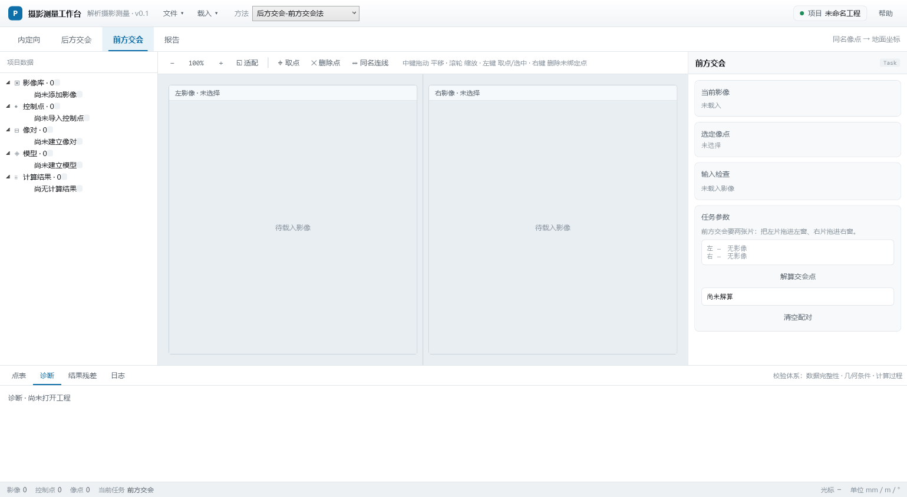
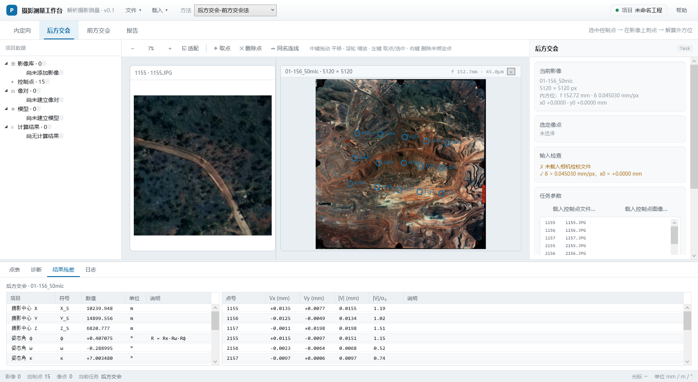
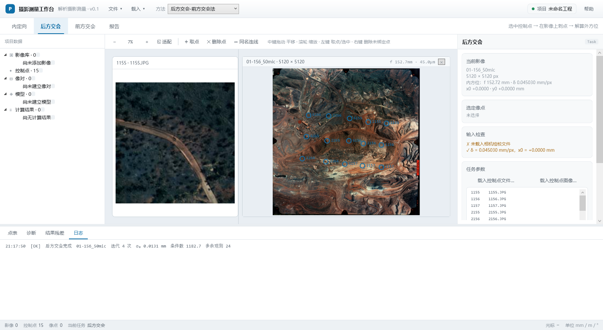
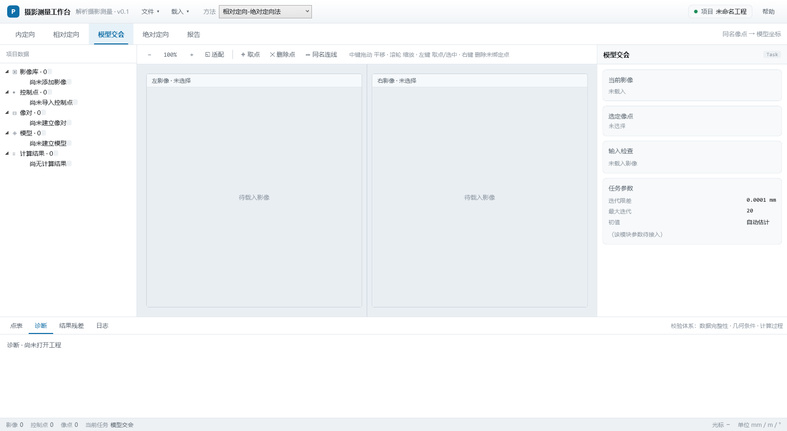
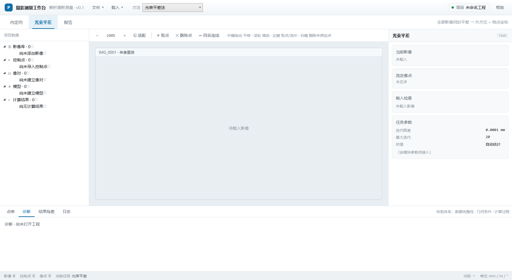

# 摄影测量工作台 · 界面设计规范

版本 1.2（2026-11-07 拆分）｜ 状态：定稿，作为实现依据
可交互原型：`Design/ui-prototype.html`（页面结构与本文一一对应）

> **本文只讲界面。** 进度见[路线图](路线图.md)；坐标与单位见[算法笔记 §0](算法笔记.md)；
> 字段与文件格式见[工程文件格式](工程文件格式.md)；C#/C++ 边界见[计算接口](计算接口.md)；
> 校验规则（VL-xx）见[路线图 §6](路线图.md)。本文只定义"界面应当是什么样"。

---

## 1 范围

**覆盖**：单像 / 双像工程的数据管理，内定向（参数式与框标仿射式）、后方交会、前方交会、相对定向、模型交会、绝对定向、报告输出、项目持久化、**核线几何**、**基于 OpenCV 的特征匹配**（M10）。

**不覆盖**：区域网平差、密集匹配、DEM / 正射影像生产。**特征检测与描述子不自己写**，用现成库——理由与边界见[计算接口](计算接口.md)、ADR-22。

**实现形态**：C# + WPF 桌面程序。平差计算由 C++ DLL 通过 C ABI 提供（MSVC 构建），数据适配与流程控制在托管层——边界见[计算接口](计算接口.md)。依赖第三方库的部分（OpenCV）单独编成 `photogrammetry_cv.dll`，主 DLL 保持零依赖。

---
## 2 数据模型

### 2.1 实体

```
Project 工程
├── Camera[]         相机        内方位元素 + 框标坐标（多张影像可共用）
├── Image[]          影像        引用一个相机、外方位元素、框标观测
├── Gcp[]            控制点      工程级已知量
├── StereoPair[]     像对        相对定向元素的宿主
├── Model[]          模型        绝对定向的输入与输出
└── Result[]         计算结果    报告的唯一数据源
```

框标属于**相机**而不属于影像：同一台相机的 8 个框标坐标是固定的，每张影像只是各自量了一组像元坐标。把框标挂在影像上，会导致同一相机的标定数据重复 6 份、改一处漏五处。

`Image → StereoPair → Model` 是三级依赖，不可合并：像对既不属于左片也不属于右片；模型点由相对定向与模型空间前方交会产出，必须独立存储。

### 2.2 字段

字段、类型与约束的**唯一出处**是[工程文件格式](工程文件格式.md)（它以 `src/Core/ProjectFile.cs` 为准），
本文不再复制一遍：两处各写一份字段表，迟早有一处先过期。这里只保留上面那张实体依赖图——
它决定了数据树怎么长、检查器按什么分发。

### 2.3 约束

- 一个 `ImagePoint` 只能归属一个 `Gcp` 或一个 `TiePoint`。
- 同一 `Gcp` 在同一 `Image` 上最多一个像点。
- `Gcp.Type == 检查点` 的点不参与解算，仅在结果中输出不符值。
- 删除 `Image` 时，级联删除其全部 `ImagePoint` 与 `FiducialMark`，并从受影响的 `StereoPair` 中移除该像对。
- 同一 `Fiducial` 在同一 `Image` 上最多一个 `FiducialMark`。
- `FiducialMark` 少于 4 个时不得执行仿射内定向（VL-07，见[路线图 §6](路线图.md)）；3 个时方程数与未知数相等，残差恒为 0，无法检核。
- 删除 `Camera` 前必须确认没有 `Image` 引用它；框标修改后，引用该相机的影像内定向结果标记为失效。

---

## 3 界面结构

### 3.1 五区

```
┌─────────────────────────────────────────────────────────────────┐
│ 标题栏  [P] 名称 · 文件▾ · 载入▾ ……… 工程名 · 帮助              │
├─────────────────────────────────────────────────────────────────┤
│ 模块栏  [方法 ▾] 该方法的步骤序列（从左到右即执行顺序）         │
├──────────────┬──────────────────────────────┬───────────────────┤
│ 数据树       │ 影像工作区                   │ 检查器            │
│ 268 px       │ 自适应                       │ 372 px，可浮动    │
├──────────────┴──────────────────────────────┴───────────────────┤
│ 底部面板  点表 │ 诊断 │ 结果残差 │ 日志                         │
├─────────────────────────────────────────────────────────────────┤
│ 状态栏  计数 · 光标坐标 · 校验汇总 · 单位                       │
└─────────────────────────────────────────────────────────────────┘
```

实际渲染（`--module 前方交会`，离屏截图，1539×844）：



职责边界（违反即返工）：

| 区 | 职责 | 禁止 |
|---|---|---|
| 数据树 | 实体层级、当前选中 | 参数输入 |
| 工作区 | 影像显示、取点、连线、缩放平移 | 计算、结果展示 |
| 检查器 | 当前选中实体的属性、当前任务的参数与提示 | 数据树操作、**解算结果**（见 3.4） |
| 底部 | 点表、诊断、**结果与残差**、日志 | 编辑影像 |
| 状态栏 | 计数与只读状态 | 任何按钮 |

### 3.2 中央工作区四态

| 态 | 用于 | 布局 |
|---|---|---|
| 单图 | 内定向、光束平差（暂定，形态未定） | 1 个视窗占满 |
| 刺点 | 后方交会 | 左 340 px 控制点放大影像（对照，不可点）+ 右整幅航摄影像（刺点），各自缩放 |
| 双图 | 前方交会、相对定向、模型交会、绝对定向（暂） | 左右 1:1，同名点连线 |
| 模型 | （暂无）等三维模型视图落地后给绝对定向用 | 单视窗，透视地面网格 + 模型点 |
| 报告 | 报告 | 白纸预览，无交互 |

所有视窗的缩放与平移**各自独立**：每个视窗持有自己的 `(s, tx, ty)`，互不影响。工具栏的缩放/适配作用于鼠标所在的视窗（`ActiveView`）。

刺点形态的左窗只是**对照**：它不做命中判定、不产生像点。找不到放大影像时左窗显示一行提示，刺点照常进行——没有对照也不该挡住作业。

### 3.3 检查器

内容由**当前选中实体的类型**决定，不由当前模块决定。模块只决定"任务面板"那一栏。

| 选中 | 检查器显示 |
|---|---|
| 影像 | 内方位元素、外方位元素（若有）、状态 |
| 像对 | 相对定向元素、Q 中误差、像点列表 |
| 模型 | 七参数、控制点不符值、检查点偏差 |
| 控制点 | X/Y/Z、类型、各影像观测 |
| 同名点 | 各影像像点、残差、是否参与解算 |

检查器可停靠（默认右栏）或浮动（无边框窗口，非模态）。浮动后内容不变，仍只显示单个选中对象。

> 现状：右栏固定是「当前影像 / 选定像点 / 输入检查 / 任务参数」四块，按选中实体切换**未实现**（没有 `DataTemplate` 分发）。解算结果在「结果残差」页（3.4、ADR-20），右栏只剩参数与提示。

**各模块只显示各自的事**：「输入检查」（框标测了几个、$\delta$ 多少、要不要相机检校文件）是**内定向**
的待办清单，只在内定向模块出现；「当前影像」卡里的内方位行同理。别的模块不转述上一步的状态——
它们要的是「能不能算」。缺前置时由**解算前的闸门**拦下（`GateBlocked`）：一句话进日志、底部状态条标红、
并把底部页签切到「日志」。不弹模态框——同一句话挡在屏幕中央，连点几次就得关几次。

### 3.4 底部面板

| 页签 | 内容 | 高度 |
|---|---|---|
| 点表 | 当前任务要用到的点。内定向列框标（像平面坐标 / 方位 / 像元），后方交会列控制点（地面坐标 / 类型 / 像平面坐标 / 像素 / 残差），相对定向列同名点（左右两片坐标 / $q$ / 状态）。选中一行即把该点设为"下一个要点的点" | 198 px |
| 诊断 | 三层校验结果。只写**要不要你处理**：失败原因、缺什么、哪张片有问题 | 198 px |
| 结果残差 | **所有模块**解出的元素（左表）与逐点残差（右表），见下 | 198 px，出结果时撑到 240 px |
| 日志 | 时间戳 + 级别 + 消息。记**过程**：每次解算的对象、迭代次数、$\sigma_0$、条件数、多余观测 | 198 px |

面板高度用上方那条分隔条拖（结果表动辄十几行，写死 198 px 只够看三行）。结果页第一次出内容时自动撑到 240 px；用户拖过之后就不再自动改——手动调过的高度不该被程序抢回去。

> 设计稿写的是"切到点表自动加高到 272 px、切回恢复"。未实现：同一块高度被四个页签共用，自动改高度会与用户拖动打架，实测也更烦人。现在只有"出结果时撑一次"这一条自动行为。

**结果残差页：两张表，四个模块一个样子**

解算结果**不放右栏**（ADR-20）。这一页固定是「左元素表 + 右残差表」，四个模块共用一套排版：

| 位置 | 列 | 放什么 |
|---|---|---|
| 左：元素表 | 项目 / 符号 / 数值 / 单位 / 说明 | 解出来的是什么：内定向的 $s_x,s_y,\delta,x_0,y_0$；后方交会的 $X_S,Y_S,Z_S,\varphi,\omega,\kappa$；前方交会的 $X,Y,Z,\gamma$；相对定向的 $\mathbf b,\varphi_2,\omega_2,\kappa_2$；外加 $\sigma_0$、多余观测、条件数这些"这个结果靠不靠得住"的量 |
| 右：残差表 | 点号 / 各残差列 / 状态 / 说明 | 每个点差多少：内定向列框标 $v_x,v_y$，后方交会列控制点 $V_x,V_y,\lvert V\rvert,\lvert V\rvert/\sigma_0$，前方交会列左右两片的 $v_x,v_y$，相对定向列同名点 $q$、$q/\sigma_0$ 与是否被剔除 |

- 列名与列数随模块变，行高、字号、配色只有一份。四个模块各写一套等宽文字块，判"哪个点偏大"的写法就会各不相同，也没法选中、没法对齐。
- 偏大的那一行**整行染成错误色**（框标 $5\sigma_0$、控制点 $|V|/\sigma_0>3$、同名点被判粗差），不用人拿眼睛比。
- **这一页只有标题 + 两张表**，不加任何解释性文字：坐标系（判手性、换轴）在 `Core` 里做完就算完，界面上不写是哪个系、也不写怎么换的（ADR-21）；"条件数偏大""冻结了哪个基线分量""两条视线差多少"这类提醒**全文进日志**，诊断页只留一句"有 $N$ 条提醒（见日志）"。页脚只在**失败**时出现，写清原因——成功时页脚是空的。
- **失败也进这一页**：左边一行"未解出/未采用"，原因写在页脚；后方交会"解出来了但没过闸门"时数值照给，但每行都标成诊断值、标题整块染红——没见过失败结果的人最容易把诊断值当解。
- 这一页是**快照**：记的是"上一次按解算时算出的东西"，标题只有「任务 · 对象」（哪张片、哪个像对）。改了观测不会自动重算，要再按一次解算。没人希望删掉一个点之后结论悄悄变了。
- 标题上**不写"成功"、不写迭代几次、不写时刻**：那些是过程，进日志（ADR-21）。标题只在失败时多一个"未解出 / 未采用"，因为翻回来的人必须先看见这件事。



日志页（同一次后方交会解算之后）：



点表的列随模块切换，**不要**做成两张独立面板（ADR-16）。

点表本身只读，表头不放命令按钮。删除分两级，各归其位：

| 动作 | 位置 | 作用范围 |
|---|---|---|
| 删掉某一个点 | 点表里右键那一行 | 当前影像上的那一个框标 / 那一个刺点 |
| 清空本影像的点 | 模块面板（内定向「清空本影像框标」、后方交会「清空本影像刺点」） | 只清当前影像，别的片不动 |

同一件事在两个地方各有一个入口，作业员就不知道按哪个、也不知道按了作用在几张片上——M3 第一版在表头放过一对「清除」按钮，就是这个毛病，已删。

### 3.5 色彩与主题

界面为浅色主题：白底、深色字，强调色只用于可交互元素与状态，不做大面积填充。

| 用途 | 色值 |
|---|---|
| 窗口背景 | `#F4F6F8` |
| 面板 / 卡片 | `#FFFFFF` |
| 次级面板 | `#F7F9FA` |
| 分隔线 | `#E1E6EB`（细）/ `#C9D2D9`（粗） |
| 主要文字 | `#16191D` |
| 次要文字 | `#58636E` |
| 弱化文字 | `#8B959F` |
| 强调（选中、链接、当前页签） | `#0F6FA8` |
| 成功 / 警告 / 错误 | `#1E8E5A` / `#A86A12` / `#C0392B` |
| 工作区底色 | `#E9EEF3` |

### 3.6 窗口与缩放

- 主窗口启动即为最大化，`MinWidth 1100 / MinHeight 720`。
- 应用程序清单声明 Per-Monitor V2 DPI 感知，避免高缩放比例下窗口超出屏幕、标题栏按钮不可达。

#### 4.6.1 「匹配质量」独立窗口

图表与三维结果**不住在主窗里**，单开一个非模态窗口（`MatchReportWindow`），两个页签：

| 页签 | 内容 | 数据 |
|---|---|---|
| 直方图 | 核线残差、交会角两张等宽分箱柱状图 | `AutoIntersectPoint.EpipolarMm` / `Ground.ConvergenceAngleDeg` |
| 点云 | 交会点的三维散点（HelixToolkit），拖动旋转、滚轮缩放、中键平移、双击复位 | `AutoIntersectPoint.Ground.Point`（`GroundPointM`，米） |

- 点云页签下方**只有一行**：点数、X/Y/Z 跨度、三个操作提示。不写"这是什么坐标系""为什么 Z 是扁的"——那是内部实现（ADR-21）。
- 这一页看的是**稀疏连接点**，一点一对同名点，几百到几千；**不是稠密点云**。别把"点少"读成"算法坏"。
- 根元素**不带 `Margin`**：离屏截图（`Snap --cloud-demo`）按根元素的布局位移截取，Margin 挂在根上会让底部被切掉。留白用 `Border.Padding`。

---

### 3.7 影像库与工作区

这是两个不同的东西，必须分开：

| | 影像库 | 工作区 |
|---|---|---|
| 存在形式 | 数据树中的影像节点 | 视窗里显示的影像 |
| 数量 | 工程内全部影像，N 张 | 最多两张（双图） |
| 生命周期 | 随工程保存 | 随会话变化，不写盘 |
| 谁拥有数据 | `Project.Images` | 不拥有，只引用 |

操作规则：

| 操作 | 行为 |
|---|---|
| 双击影像行 | 载入到下一个可用视窗 |
| 拖拽影像行到视窗 | 载入到指定的那个视窗（左右各一） |
| 视窗标题栏 × | 从工作区移除（不删除数据） |
| 树上右键「从工作区移除」 | 同上 |
| 树上右键「载入到工作区」 | 同双击 |
| 树上右键「从工程移除…」 | 从工程索引中删除，**磁盘文件不动**；弹出确认 |

右键必须先选中光标下的节点，再弹菜单。WPF 的 `TreeView` 右键**不会**改变 `SelectedItem`；不做这一步，菜单只会作用在上一次选中的节点或空选中上，表现为"点了没反应"。

**拖拽只是快捷方式，不能是唯一入口。** 双击、右键菜单必须提供同等能力：拖拽的可发现性差，触控板用户与键盘用户都用不了。

数据树用徽标显示该影像当前在哪个视窗（`单` / `左` / `右`），让"库里有 N 张、正在看哪两张"一眼可见。这是工作区状态的唯一入口，不要另外做状态栏。

### 3.8 菜单结构

顶部两个下拉，按「作用于工程」与「往工程里加东西」分开：

**文件**（工程生命周期）

| 项 | 快捷键 | 说明 |
|---|---|---|
| 新建工程 | Ctrl+N | 清空当前工程 |
| 打开工程… | Ctrl+O | 读 `.pht` |
| 保存工程 | Ctrl+S | 无路径时弹另存为 |
| 另存为… | Ctrl+Shift+S | |
| 退出 | — | |

**载入**（往工程里加影像）

| 项 | 快捷键 | 状态 |
|---|---|---|
| 影像… | Ctrl+I | 可用，可多选 |

规则：

- **打开工程 ≠ 打开影像**。前者换掉整个工程，后者只是往库里加东西，两者绝不能共用一个按钮。
- **某个流程的数据，只在该流程的界面里载入**（ADR-15）。相机检校文件进「内定向」面板，控制点文件与放大影像进「后方交会」面板。全局「载入」只留影像——它是唯一跨模块的外部数据。
- 数据树里不再放命令按钮，树只表达数据状态。

各模块的数据入口：

| 数据 | 入口 | 位置 |
|---|---|---|
| 影像 | 载入 ▾ → 影像… | 顶部菜单 |
| 相机检校文件（`.cmr` / CSV） | 载入相机检校文件… | 内定向 → 任务参数 |
| 控制点文件（`.rtf` / CSV） | 载入控制点文件… | 后方交会 → 任务参数 |
| 控制点放大影像 | 载入控制点图像…（多选，文件名用点号） | 后方交会 → 任务参数，按钮下方是已载入清单 |

### 3.9 从工程派生的界面状态

界面不单独持久化布局状态以外的东西。工程打开后：

- 数据树由 `images / gcps / pairs / models / results` 直接生成；
- 检查器内容由当前选中实体的类型决定；
- 上次选中的实体 ID 与各模块的视图变换（缩放、平移）写入工程文件的 `ui` 段，便于恢复现场。

---

## 4 模块定义

| 模块 | 工作区 | 必需输入 | 输出 | 阻止计算的条件 |
|---|---|---|---|---|
| 内定向（参数式） | 单图 | f, x0, y0, 像元尺寸, 影像尺寸 | 换算参数 | 任一参数 ≤ 0 |
| 内定向（框标仿射） | 单图 | ≥4 个框标的像元坐标 + 其像平面坐标(mm) | 6 个仿射系数、反算的 δ/x0/y0、逐点残差、σ₀ | 框标 < 4、框标近似共线 |
| 后方交会 | 刺点（左对照 + 右工作） | 内方位元素、≥4 个控制点与其像点 | 6 外方位、逐点残差、σ₀、参数中误差、法方程条件数 | 控制点数 < 4、近共线、缺内参、迭代不收敛 |
| 前方交会 | 双图 | 两像**绝对**外方位、一对同名点（左右各点一次） | 地面坐标 X/Y/Z（数学系）+ 交会角、基线、摄影距离、上下视差、$m_X/m_Y/m_Z$ | 缺内定向、缺绝对外方位、两张是同一片、焦距不一致、只点了一边、点出框幅、视线平行 |
| 相对定向 | 双图 | ≥6 对同名点（5 个未知数 + 1 个多余观测） | 5 元素 + Q 中误差 | 同名点 < 6、分布退化 |
| 模型交会 | 双图 | 一对**已相对定向**的像对；控制点在两片上都刺过点 | 每个控制点的**模型坐标** X/Y/Z + 交会角 | 无像对、相对定向未解、缺内参、没有两片都刺点的控制点 |
| 绝对定向 | 双图（暂） | 已解相对定向的像对、≥3 个控制点在**两片上都刺点** | 7 参数（λ + 3 角 + 3 平移）+ 控点不符值 + 检查点偏差 | 无像对、未解相对定向、缺内参、两片公共控点 < 3 个、控点共线 |
| 报告 | 报告 | 至少一条 Result | HTML | 无结果 |

> **实现状态（2026-11-07）**：两条作业方法的界面都整条接通了。`光束平差` 只有按钮，明确不做（[路线图 §1](路线图.md)）。
>
> 两处与设计稿不同，都是因为原设计依赖的东西还不存在：
> ① **控制点刺在「模型交会」格里**，不是「后方交会」——绝对定向要的输入是"每个控制点一个模型坐标"，那正是模型交会的产物；名字由刺点给出，所以刺点天然属于这一步。两格**互不调用**，只共用「控制点导入」与「刺点」这两件通用设施。
> ② **绝对定向的工作区用双图**，不是「单视窗 + 透视地面网格」——那个模型视图至今是占位图，进去只有空白网格。双图不新增元素。三维视图做出来后再按原设计切回。

**作业方法在标题栏的下拉框里选**（`载入 ▾` 右边），模块栏只显示所选方法的步骤，从左到右即执行顺序。三条方法中间几步不同，首尾都是内定向与报告：

| 方法 | 模块栏显示的步骤 |
|---|---|
| 后方交会-前方交会法 | 内定向 → 后方交会 → 前方交会 → 报告 |
| 相对定向-绝对定向法 | 内定向 → 相对定向 → 模型交会 → 绝对定向 → 报告 |
| 光束平差法 | 内定向 → 光束平差 → 报告 |

切换方法时若当前模块不在新方法里，自动落到新方法的第一步——否则会出现「选中的按钮已被藏起来、模块栏看起来一个都没选中」的状态。`--module` 这类外部驱动也必须同时决定方法，这件事集中在 `MainWindow.SelectModuleForTooling` 里做，工具不自己去猜。

后两种方法下的模块栏（第一种见 §3.1）：





为什么显式选而不是把七个按钮全摆出来：同一句「交会」，在第一条方法里求**地面**坐标，在第二条方法里求**模型**坐标。全摆出来等于让作业员自己判断哪些按钮属于同一条路，而误判的表现不是报错，是引用了一套不属于本次作业的中间结果。

**前方交会与模型交会是同一个求交内核**：两条射线求交只要求两个相机位姿表达在同一个坐标系里，那个系叫「地面」还是「模型」对数学没有区别。区别只在于喂进去的位姿从哪来——绝对外方位，还是相对定向后把左片定为基准（$0,0,0,0,0,0$）、右片为 $(B_x,B_y,B_z,\varphi_2,\omega_2,\kappa_2)$ 得到的模型系姿态。所以 `pgm_forward_intersection` 只负责求交，坐标系的语义由调用方承担；在方法二里绝不另写一份求交。

两种内定向方式是**互斥的模式**，不是同一界面上的两套按钮：选参数式就不碰框标，选框标仿射左键就只走框标、绝不新建像点。框标坐标可以来自相机文件，也可以在「编辑框标…」里手工录入或改正——厂家给的文件格式与内容都不保证。

模块之间不共享界面代码，只共享工作区、检查器、校验器、结果渲染器四个组件。新增模块 = 新增一个任务定义，不新增窗口。

---

---

## 5 交互规范

### 5.1 鼠标

| 操作 | 行为 | 约束 |
|---|---|---|
| 中键按下拖动 | 平移 | 按下即进入，松开退出，光标变抓手 |
| 滚轮 | 缩放 | 锚定光标位置；范围 5%–800%；每格 ×1.16 |
| 左键单击空白 | 取点 | 新建像点，编号自增，虚线圈表示未绑定 |
| 左键单击已有点 | 选中 | 命中半径 10 px（随缩放等比换算） |
| 右键 | 取消 | 见 5.3 |
| 双击点标记 | 编辑 | 打开检查器对应属性 |
| 无中键设备 | 空格 + 左键拖动 | 与中键等价 |

左键的"取点"与"选中"由命中判定区分，不设模式开关：命中半径内存在标记则选中，否则新建。

### 5.2 键盘

| 键 | 行为 |
|---|---|
| Esc | 等同右键 |
| Delete | 删除选中的未绑定像点 |
| ← / → | 切换模块 |
| Ctrl+S | 保存工程 |
| 空格 + 拖动 | 平移 |

### 5.3 取点、绑定与取消

1. 左键在空白处取点 → 生成未绑定像点（虚线圈）。
2. 绑定方式：在点表里选中目标控制点 → 在影像上左键取点即完成绑定。不自动切换影像、不自动跳转，一次只处理当前这张影像。
3. 右键：
   - 当前选中点为未绑定 → 删除该点；
   - 当前选中点已绑定 → 仅取消选中，不删除数据。
4. 已绑定的点只能用「删掉本片上的点」显式删除；右键只取消选中，不做破坏性操作。
5. 删除的可发现性不能只靠键盘：工具栏提供「删除点」按钮，Delete 键只是快捷键。只给快捷键会让人以为"删不掉"。
6. 框标取点模式下，左键不再新建像点，而是给当前框标取点；右键撤销刚取的那个框标。框标量测另有「清空框标」按钮。

### 5.4 状态栏光标读数

工作区内移动鼠标时实时显示：`px 2843, 1902 · mm -0.71, -1.86`。该读数由内定向换算产出，与算法层使用同一实现。

---

---

## 6 WPF 实现映射

| 规范条目 | 控件 / 类型 |
|---|---|
| 五区 | `MainWindow` + `Grid`（46 / 42 / * / 5 分隔条 / 198（出结果 240）/ 26） |
| 数据树 | `TreeView` + 分层 `HierarchicalDataTemplate` |
| 工作区 | `ImageWorkspace`（UserControl），按 3.2 切换子视图 |
| 单个视窗 | `ImageView`：`Canvas` 承载缩放层与标记层，自行实现变换，不使用 `Image` 控件硬撑 |
| 检查器 | `ContentControl` + 按选中实体类型选择 `DataTemplate` |
| 检查器浮动 | 无边框 `Window`，`ShowInTaskbar=false`，`Owner=主窗` |
| 底部分页 | `TabControl` |
| 点表 | 三个 `DataGrid`（框标 / 控制点 / 同名点），按模块切换可见性，共用一套行列样式 |
| 状态栏 | `StatusBar` + `TextBlock` |

检查器的类型分发用 `DataTemplate.DataType` 完成，禁止用 if/else 判断实体类型。

---

## 7 决策记录

> ADR-12（数据策略）已移到[路线图 §5](路线图.md)；ADR-14 / ADR-18 / ADR-22（C++/ABI/OpenCV）
> 已移到[计算接口 §5](计算接口.md)。编号保持不变，别处按编号引用不会断。

| 编号 | 决策 | 理由 |
|---|---|---|
| ADR-01 | 检查器按实体类型切换，不做"全类型点列表窗口" | 五类点的字段与操作不同，合并后仍需分组，等于没合并 |
| ADR-02 | 数据模型引入 `StereoPair` 与 `Model` | 相对定向、绝对定向的结果无处归属，流程在中间断裂 |
| ADR-03 | 控制点用底部停靠表，不用浮动窗口 | 需与影像双向联动，浮动窗口在拖动时遮挡点位 |
| ADR-04 | 刺点一次只处理当前影像，不自动跳转 | 自动跳转会导致误绑，且无法在单张影像上连续修正 |
| ADR-05 | 右键语义为"取消"，不承载删除已绑定数据 | 删除属破坏性操作，必须走显式路径 |
| ADR-06 | 双图缩放平移**各自独立** | 两图尺寸、比例尺、定向状态都可能不同，共享同一变换会让一张适配、另一张错位。真正的联动是"同步运动 + 固定视差偏移"，属 M6 立体观测，届时以开关形式提供 |
| ADR-07 | 界面采用浅色主题 | 深色底长期使用视觉疲劳；教学演示投影也以浅底更清晰。`Design/ui-prototype.html` 的深色版仅保留结构参考，配色以 4.5 为准 |
| ADR-08 | 主窗口启动即最大化 | 高 DPI 下固定尺寸窗口会超出屏幕，标题栏按钮不可达 |
| ADR-09 | 影像库与工作区分离，拖拽/双击/右键三入口并存 | 工程是持久的，视图是临时工作集；拖拽可发现性差，不能作为唯一入口 |
| ADR-10 | 顶部拆「文件」与「载入」两个菜单 | 打开工程与添加影像是两个层级完全不同的动作，共用一个按钮会造成误操作 |
| ADR-11 | 内定向做两档：参数式（已知内参）+ 六参数仿射（框标） | 参数式是仿射式的受约束特例，一套实现即可覆盖。仿射能吸收扫描比例、旋转、轴不正交与主点偏差，是真实数据的必需能力 |
| ADR-13 | 框标属于 `Camera`，不属于 `Image` | 同一相机的框标坐标固定，每张影像只是量了各自的像元坐标。挂在影像上会让标定数据重复 N 份，改一处漏 N−1 处 |
| ADR-15 | **某个流程的数据，只在该流程的界面里载入**。`载入 ▾` 只留「影像…」；相机检校在「内定向」面板，控制点文件与放大影像在「后方交会」面板 | 顶部的全局菜单只承载"往工程里加影像"这种跨模块动作。把相机、控制点的入口放进去，会让人在相对定向的界面里看到一堆与本任务无关的命令，还会误以为数据已经就绪。入口跟着任务走，缺什么就在缺它的地方给 |
| ADR-16 | 底部「点表」一张表、两套列，按模块切换 | 内定向要框标（像平面坐标 + 方位 + 像元），后方交会要控制点（地面坐标 + 类型 + 像平面坐标 + 像素 + 残差）。列不同但都是"当前任务要用到的点"，做成两张独立面板会让底部页签越堆越多 |
| ADR-17 | 视窗按模块分层画标记：内定向只画框标，后方交会只画已绑定控制点的像点 | 两组点叠在一张图上，作业员无法判断哪些属于当前任务。M3 实测中确有"内定向界面里冒出控制点符号"的问题，原因就是所有层都画 |
| ADR-19 | **作业方法用标题栏下拉框选择，模块栏只显示所选方法的那一串步骤** | 三种方法的中间步骤不同：同一个「交会」在后方交会-前方交会法里出地面坐标，在相对定向-绝对定向法里出模型坐标。全部平铺成一行，等于让作业员自己判断哪些按钮属于同一条路，而误判不报错——只会引用一套不属于本次作业的中间结果。用下拉框后，模块栏本身就是该方法的流程，不需要额外标注并行或互斥。代价：多一个界面状态（当前方法）要维护，切换时要处理「当前模块被藏起来」的落位；且 `--module` 这类外部驱动必须连方法一起决定，已集中到 `MainWindow.SelectModuleForTooling` |
| ADR-20 | **解算结果集中到「结果残差」页，右栏只放参数与提示**，四个模块共用「左元素表 + 右残差表」 | ①结果是拿来比、拿来抄进报告的：等宽文字块排版对不齐、选不中，还各自实现一套"哪个点偏大"；②右栏是可滚动的窄栏，结果块常落在折叠线以下，解完等于没显示，得靠 `BringIntoView` 找补；③统一成两张表后，列名随模块变、行高配色只有一份，偏大的行整行染色。代价：结果页是**快照**（改了观测要重解），且解完自动切页签会打断"边解边点"的节奏——所以只在真的解算过之后才切 |
| ADR-21 | **过程信息归日志，坐标系的事不出现在界面上** | ①"成功、迭代 4 次、σ₀、条件数"是过程，摆在结果页上会被当成结果的一部分去引用，而它每次都不同、没有引用价值——进日志既留了痕又不占地方；②诊断页只写"要不要你处理"，成功不出声，失败才出声；③判手性、换轴是 `Core` 的内部数据适配（ADR-18），做完了界面只该给一套坐标，再解释"这个文件是 X 指北、我给你换成了 X 指东"等于把内部实现摆到台面上，作业员既不用知道也无法处理。代价：看日志要自己切页签；换轴若真判错，界面上看不出痕迹——靠 `--control` 的"换轴后解回同一真值"与闸门兜底 |
| ADR-23 | **「匹配质量」窗口带两个页签：直方图 + 点云；三维用 `HelixToolkit.Wpf` 3.1.2（MIT）** | ①图表和三维结果都是"看一眼就关"的东西，不该住进主窗，也不该拆成两个窗口；②三维交互、相机控制、坐标轴指示是成熟库的活，自己写一遍纯属浪费——先确实自绘过一版（`WriteableBitmap` 正交投影，约 250 行），但那**只是因为装不上包**：`src/NuGet.config` 里的 `<clear />` 让 `dotnet add package` 报 NU1101「找不到包」，连带一条误人的「与所有框架不兼容」。补上 nuget.org 源后当场换成 HelixToolkit，自绘那版整个删掉；③这一档用 WPF 自带的软件三维，几千点很轻松，**几百万点的稠密云扛不住**，到那一步再评估 `HelixToolkit.Wpf.SharpDX`（DirectX 11）；④包只进 `App`，`photogrammetry.dll` 依旧零第三方依赖，ADR-22 的边界没动。教训：`<clear />` 式的"完全离线"配置会把失败点从"没网"挪到"看不懂的 NU1101"，注释里写了后路也不够——真要用就得当场改 |

---

## 附录 A 原型对照

| 原型页面 | 入口 |
|---|---|
| 相对定向（双图） | `ui-prototype.html` |
| 后方交会（单图） | `#resect` |
| 绝对定向（原型是模型态；实现暂用双图） | `#absolute` |
| 报告 | `#report` |
| 控制点点表 | `#resect,meas,0` |

> 模型交会沿用「双图」态的布局，暂无独立原型锚点。它的右栏是**自己的三件**（一句能不能求、一行像对、载入控制点 + 求模型点），不复用后方交会的面板。