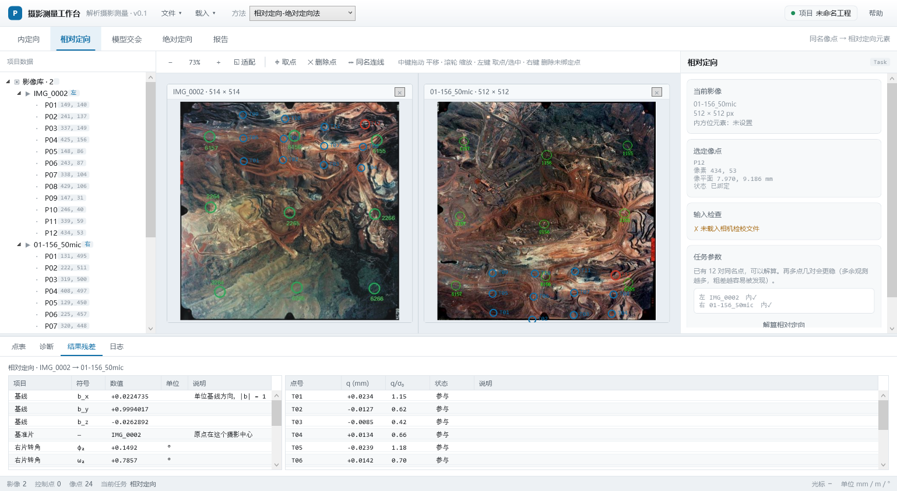

# 摄影测量工作台 · 路线图

> **本文是项目进度的唯一真源。** 其他文档只引用这里的里程碑编号，不另建进度表。
> 每次阶段推进，先改本文，再改代码。

更新于 2026-11-04

---

## 0 目标

用一个能运行、能对答案、能讲清楚的桌面程序，走完摄影测量的主要计算链：

```
影像 → 内定向 → 像平面坐标 ─┬→ 后方交会 → 外方位 ─────────────┐
                            │                                ├→ 前方交会 → 地面坐标
                            └→ 相对定向 → 核线 → 自动匹配 ───┘→ 模型点（M11）
```

不做：区域网平差、密集匹配、DEM / 正射影像。理由见[界面设计规范 §1](界面设计规范.md)。

**自动匹配要做**（2026-11-04 起，M9–M11）：老师确认可以直接用现成的计算机视觉库，所以不自己写特征
检测，用 OpenCV；几何这边不放过——核线约束自己算，拿它把匹配候选压到一条线上。理论见
[核线算法.md](核线算法.md)。

---

## 1 现在在哪

| | |
|---|---|
| 当前阶段 | **M1–M6 完成；M6.5 / M7 暂停，转入 M9 核线几何 → M10 计算机视觉匹配** —— M9 已开工，紧随其后 M10 |
| 已完成 | M1 / M2 / M3 / M4 全部；M5 的 DLL（七段）与 `Snap --intersect` 十四项、界面「前方交会」模块；M6 的 C++ 内核（七段自检）、托管层 `RelativeOrientationTask`、`Snap --relative` 26 项端到端、点表「同名点」、`.pht` v3（同名点与相对定向结果落盘）；作业方法下拉（三种方法、模块栏按方法过滤）；结构重构第 1–6 步（见[重构计划 §9](重构计划.md)） |
| 进行中 | M9 核线几何（核线 / 核点 / 点到核线距离已落地，核线重采样待做）；M6 剩下双图立体联动 |
| 暂停 | **M6.5 模型交会、M7 绝对定向**（2026-11-04 起）。手工点对应那条路先放一放；M11 会用自动匹配把「同名点 → 模型点」这一段接起来，内核与 M6.5 同一套 |
| 阻塞项 | `Data/real` 里有 `01-155/156/157`、`02-164/165/166` 六张原片和 `PointPos/` 里的同名点位，`Snap --relative-demo` 就是拿 `01-156` / `02-165` 那对跑通的；但那两张点位图是 512 见方的缩略图，M10 的匹配精度要在你自己的原片上测 |

---

## 2 里程碑总表

| 里程碑 | 名称 | 一句话交付 | 关键验收 | 依赖 | 状态 |
|---|---|---|---|---|---|
| **M1** | 骨架与视窗 | 五区界面、影像显示、缩放平移、取点、工程读写 | 锚点不漂移；重开后点位与视图还原 | — | ✅ 完成 |
| **M2** | 内定向 | 参数式 + 框标六参数仿射，输出 δ/x₀/y₀ | 真实数据两片 δ 相差 0.004%；σ₀ 0.012–0.020 mm | M1 | ✅ 完成 |
| **M3** | 控制点与点表 | 控制点文件导入、点表、刺点绑定、放大影像对照 | 导入 15 点不丢行；一个控制点在一张片上最多一个像点 | M2 | ✅ 完成 |
| **M4** | 空间后方交会 | 共线方程 + 迭代最小二乘，求 6 外方位 | 往返检验恢复真值 < 1e-6；≥4 点收敛 | M2、M3 | ✅ 完成 |
| **M5** | 空间前方交会 | 三式最小二乘解投影系数，求地面坐标 + 交会角 + 精度 | 往返误差 < 1e-8 m；与教材 (5-14) 对表一致 | M4 | ✅ 完成（DLL + 托管层 + 面板） |
| **M6** | 相对定向 | 共面条件 5 元素，Q 中误差 | Q 中误差 < 0.01 mm；≥6 对同名点收敛 | M2、M3 | ✅ 内核（七段自检）+ 托管层 + 界面 + 点表持久化 |
| **M7** | 绝对定向 | 七参数相似变换 | 控制点不符值 < 2×σ₀ | M3、M6 | ⏸ 暂停（2026-11-04） |
| **M8** | 报告 | HTML 报告，含输入摘要、结果、残差、诊断 | 任一次解算都能导出可阅读的报告 | M5 | ⬜ 未开始 |
| **M9** | 核线几何 | 由相对定向的 $(\mathbf b,R)$ 求核线、核点、点到核线距离；严格核线重采样出两幅核线影像 | 合成像对：同名点行坐标差 < 0.01 px；核线过核点、点到其核线 < $10^{-9}$ mm | M6 | 🔄 进行中 |
| **M10** | 计算机视觉匹配 | OpenCV 特征 + 核线约束 + 比值检验 + RANSAC，自动出同名点对并进点表 | Hammer 真像对：正确匹配 ≥ 80 对、核线残差 < 1 px、无整幅错配 | M9 | 🔄 内核已通（987 对、q_rms 0.017 mm），待接界面 |
| **M11** | 自动交会 | 匹配点 → 模型点，复用 M5 的求交内核 | 与 M5 同一标准（往返 $<10^{-8}$） | M10、M5 | ⬜ 未开始 |

> **编号已按依赖重排**（2026-10 修订）：原「M5 控制点」提前为 **M3**，因为后方交会没有控制点算不了；
> 原 M3 后方交会 → **M4**，原 M4 前方交会 → **M5**。`Docs/` 下所有引用已同步。

---

## 3 各阶段明细

### M1 骨架与视窗 ✅

| 子阶段 | 内容 | 验收 | 状态 |
|---|---|---|---|
| M1-a | 解决方案分层、五区布局、主题资源、坐标类型与换算器 | 启动即最大化；换算器与手算一致到 0.001 mm | ✅ |
| M1-b | 真实影像显示、中键平移、滚轮锚定缩放、光标读数 | 缩放锚点不漂移；800% 下仍可定位 | ✅ |
| M1-c | 命中判定、编号、内存点位集合 | 命中已有标记不重复新建；右键语义符合规范 6.3 | ✅ |
| M1-d | 工程索引读写、相对路径、缺失检测、原子写 | 关闭重开，影像、点位、视图变换全部还原 | ✅ |
| M1-e | 双图各自独立变换（原缺陷修复） | 两张不同尺寸影像各自适配，互不影响 | ✅ |

> M1-e 是修缺陷补出来的：早期三个视窗共享一个 `ViewTransform`，导致双图强制同步。
> 见[界面设计规范 ADR-06](界面设计规范.md)。

### M2 内定向 ✅

| 子阶段 | 内容 | 验收 | 状态 |
|---|---|---|---|
| M2-① native 工程 | `native/`：CMake + MSVC，产出 `photogrammetry.dll` 与 C ABI 头文件 | C# 侧 P/Invoke 能调通一个测试函数 | ✅ |
| M2-② 框标仿射 | 六参数仿射最小二乘（重心化、解耦、退化检测）、系数反算 δ/x₀/y₀、逐点残差与 σ₀ | 理想取点精确复原到 1e-8；σ₀ 随输入噪声同步；3 点、共线、b₂ 符号异常均被拒 | ✅ |
| M2-③ 框标界面 | 载入相机检校文件（`.cmr` / CSV）、手工录入改正、框标列表与方位提示、解算入口、逐点残差、内参回填 | 真实数据 `01-155`、`01-156` 各点 8 个框标，δ 与基准相差 < 0.1% | ✅ |
| M2-④ 参数式内参 | f / x₀ / y₀ / 像元尺寸可编辑，「应用到当前影像」后状态栏 mm 与像点 mm 实时重算 | 参数式与框标式互不干扰，切换方式后取点行为随之改变 | ✅ |

真实数据验收基准见 [Data/real/README.md](../Data/real/README.md)。

算法说明见[算法笔记 §5](算法笔记.md)。测试数据见 [Data/sim/README.md](../Data/sim/README.md)。

### M3 控制点与点表 ✅

| 子阶段 | 内容 | 验收 | 状态 |
|---|---|---|---|
| M3-① 文件解析 | `gxyz.rtf`（Word 富文本）与普通 CSV 共用一套行解析；跳过表头/空行/超链接残留；点号重复与单位量级给出警告 | 真实文件 15 个点一行不丢，坐标与人工核对一致 | ✅ |
| M3-② 放大影像 | 「载入控制点图像…」多选，文件名（去扩展名）对点号；按钮下方是已载入清单，点一行就在左窗看它。控制点文件同目录有 `pointpos/` 时自动挂上 | 15 个点全部对上放大片；对不上点号的文件给出提示而不是静默丢弃 | ✅ |
| M3-③ 点表 | 底部一张表两套列：内定向列框标（像平面坐标 / 方位 / 像元），后方交会列控制点（地面坐标 / 类型 / 像平面坐标 / 像素 / 残差）；选中一行即设为待测点 | 检查点不参与解算；同一影像一个控制点最多一个像点 | ✅ |
| M3-④ 刺点 | 选中行 → 左键在影像上点 → 绑定并回算像平面坐标；重刺即移动；点表右键删单个，模块面板「清空本影像…」清整片；Esc 退出 | 无内定向时明确提示「算不出像平面坐标」 | ✅ |
| M3-⑤ 双窗对照 | 工作区新增刺点形态：左为控制点放大影像，右为整幅航摄影像，各自缩放 | 没有放大片时左窗只显示提示，刺点照常 | ✅ |
| M3-⑥ 归属与分层 | 载入 ▾ 只留影像；相机移入内定向面板、控制点移入后方交会面板；视窗按模块分层画标记；解算后外方位自动写回；离开内定向必须同时关掉框标方式 | 内定向界面里看不到刺点；内定向→后方交会切换后左键仍能刺点；解算完不必再点一次「应用」 | ✅ |

> 老师提的「工程会提供控制点放大后的影像」就是 M3-② / M3-⑤。真实数据在
> [Data/real/2_Hammer/HammerIndex](../Data/real/2_Hammer/HammerIndex)：`gxyz.rtf` + `PointPos/<点号>.JPG`。
>
> M3-⑥ 是照使用反馈补的：数据载入归属、标记分层、自动应用 —— 见
> [界面设计规范 ADR-15/16/17](界面设计规范.md)。

### M4 空间后方交会 ✅

| 子阶段 | 内容 | 验收 | 状态 |
|---|---|---|---|
| M4-① 旋转与共线方程 | $R=R_\kappa R_\omega R_\phi$、像空间 z 轴指向、$W<0$ 检查 | 与教材 $a_1..c_3$ 展开式对表偏差 < 1e-10 mm | ✅ |
| M4-② 线性化与法方程 | 平移解析偏导、角元素左乘 $M_\theta$ 构造、列平衡、对称阵特征分解求解 | 设计矩阵与中心差分相对偏差 < 1e-7 | ✅ |
| M4-③ 迭代与精度 | 四参数相似变换估初值、步长减半阻尼、σ₀ 与参数协方差、退化判据 | 往返检验恢复 1e-6；含 0.5 px 噪声收敛 ≤ 4 次；真误差 RMS/中误差 0.85–1.12 | ✅ |
| M4-④ 界面接入 | 控制点 → 像平面坐标 → 调 DLL；结果表与残差表；外方位写回影像 | 端到端回归到整像素量化误差以内 | ✅ |
| M4-⑤ 结果把关 | 自动初值与已存外方位各解一次，取残差小的；σ₀ > 10δ 或摄影中心低于测区一律拒收（VL-10/11） | 倒置解当初值仍能爬回真值；单点 30 m 粗差被拒 | ✅ |
| M4-⑥ 坐标轴序 | 三点有向面积判手性（同号右手系 / 异号换轴），换轴后再解；判定的三点、两个 sin 与投票组数记进日志 | 真实数据：换轴后 σ₀ 从 2.96 mm 掉到 0.27 mm，再剔一个点错 23 像元的粗差掉到 0.0267 mm（0.6 像元）；交换 X/Y 的合成往返仍解回真值。复盘见[外方位解错复盘](外方位解错复盘.md) | ✅ |

- **验收**：
  - **往返检验**：用已知外方位正投影生成像点，再反解，6 个元素恢复误差 < 1e-6；
  - 实测收敛（迭代 ≤ 10 次，实测 4 次）；
  - 控制点 < 4 或近共线时按 VL-01/02 阻断。
- **自检**：
  - `native/build/bin/Release/pgm_resection_test.exe`：六段检查（约定对表、往返、雅可比、噪声、退化、手算）；
  - `--control`：真实 `gxyz.rtf` 解析 + P/Invoke 封送布局；
  - `--gcp`：界面端到端（刺点 → 像平面 → 解算 → 截图）。
- **数据**：`Data/sim/m4/` 未落地；合成检验用测试程序内生成的控制点网。

### M5 空间前方交会 ✅

- **目标**：由两张片的外方位 + 一对同名点求地面坐标。
- **交付物**：`pgm_forward_intersection` —— 三式最小二乘解投影系数、交会角、两条视线的最近距离、反投影残差与剩余上下视差、$m_X/m_Y/m_Z$。
- **与教材的差别**：教材固定用 (5-13) 的第 (1)(3) 两式（$X$、$Z$），隐含「基线在航向」；旁向像对分母 $u_1w_2-u_2w_1$ 恒为零。改用三式最小二乘后，退化判据变成 $\sin\theta\to0$，与 VL-03 的交会角共用一个量。航向像对上两解同值（实测差 $1.1\times10^{-13}$）。
- **验收**：往返误差 $<10^{-8}$ m（实测 $8.9\times10^{-12}$）；与教材 (5-14) 对表一致；精度传播与蒙特卡洛吻合（0.2–1.5%）；无噪声时最近距离与上下视差为 0。
- **自检**：
  - `native/build/bin/Release/pgm_intersection_test.exe`，七段检查（DLL 侧）；
  - `Snap --intersect`，十四项检查（托管侧）：精确像点误差 $9.1\times10^{-13}$ m、交会角 49.75°、基线 2318.255 m、$N\cdot|d|$ 与距离自洽、整像素量化后 0.27 m，外加五条闸门；
  - `Snap --intersect-demo`，界面端到端：两张片各点一下 → 按解算 → 结果与真值差 0.527 m、结果页上确实显示了坐标（断言改成读结果页的行与列）。
- **托管层**：
  - `Core/NativeAbi.cs` 加 `CameraPose` / `IntersectionInput`（144 字节，内嵌两个 48 字节姿态）/ `IntersectionOutput`（144 字节），用 `Snap --abi` 逐字段对表；
  - `Core/NativeAlgorithms.IntersectRays` 做封装与解码；
  - `Core/Tasks/IntersectionTask` 做流程与闸门：缺内定向 / 缺绝对外方位 / 同一张片 / 焦距不一致 / 没点 / 点出框幅 / 退化，各有明确的失败原因。
- **界面**：`前方交会` 模块（双图）。在左窗点一个同名点、右窗点同一个点，按「解算交会点」即出地面坐标。配对用的是影像上的**临时像点**，看得见、能右键取消、「清空配对」一起收走。
- **告警（VL-03）**：交会角 $<15°$ 时提示，并把深度方向的放大倍数 $1/\tan\theta$ 算给用户看；两条视线最近距离超过基线千分之一（且 $>0.5$ m）提示"多半不是同一个点"；上下视差 $>0.10$ mm 提示。
- **坐标系**：输出在数学系（X 东、Y 北、Z 天顶）。后方交会判定出的地面轴序记在 `ImageItem.GroundOrder`（不写盘），换轴在 `Core` 里做完，界面只给换算后的一套坐标。
- **待办**：无。

### M6 相对定向 ✅（内核 + 托管层 + 界面，2026-10-28）

- **目标**：不用控制点，仅靠同名点建立像对几何。
- **交付物**：共面条件、5 个相对方位元素、Q 中误差；可选的双图立体联动（同步运动 + 保留视差偏移，默认关闭）。
- **验收**：Q 中误差 < 0.01 mm；≥6 对同名点收敛；联动开关关闭时两视窗完全独立。
- **已完成（C++ 内核）**：`pgm_relative_orientation` —— 共面条件一般式迭代、规准冻结基线主分量、初值取平均视差方向、**留一法粗差剔除**（剔掉后 $\sigma_0$ 缩 2.5 倍才算，最多 4 轮、剔完至少留 7 对）、$\sigma_0$ 与 $q_{\mathrm{rms}}$ 两套残差、条件数与冻结分量都上报。设计见[相对定向算法 §11](相对定向算法.md)。
- **已完成（托管层）**：`NativeAlgorithms.SolveRelativeOrientation`（ABI 封装）、`Core/Tasks/RelativeOrientationTask`（攒点对、闸门、文案、写回工程）、`Snap --relative`（26 项端到端自检，含"存盘→读回"）、`Snap --abi` 覆盖两个新结构体（13 个 struct / 7 个 DllImport）。
- **已完成（界面）**：右栏「相对定向」面板（配对提示、像对与点对数、解算按钮）；点表新增「同名点」表（左/右像平面坐标、$q$、状态）；模块切到相对定向时只画同名点与临时点这一层。解算结果在底部「结果残差」页（[界面设计规范 4.4](界面设计规范.md)）。
- **点对进点表**：同名点随工程存进 `.pht`（v3），解算结果写在 `pairs[].relative`、逐点 $q$ 与剔除标记写在 `tiePoints[]`。字段字典见[工程文件格式](工程文件格式.md)。
- **与教材的差别**：教材固定 $b_x=B$ 且初值取 $\mathbf b=(1,0,0)$，隐含航向像对。**旁向像对（30% 旁向重叠）会解不出来**：$b_x\to0$ 时那一列塌成零，实测会停在残差不为零的假驻点。改成"初值取平均视差方向 + 规准冻结基线主分量"后，旁向与纯旁向像对都是 4 轮收敛；航向像对算出来仍落在 $b_x$ 上，自动退回教材形式。
- **与教材的差别（粗差）**：教材/常见写法按 $|q|>3\sigma_0$ 剔点，这个判据 $n\le14$ 时剔不掉自己（详见[相对定向算法 §10](相对定向算法.md)）。改成留一法之后，$1\ \text{mm}$ 与 $2\ \text{mm}$ 的错点都能干净剔出，干净数据一个不剔。
- **自检**：`native/build/bin/Release/pgm_relative_orientation_test.exe`，**七段**（往返、雅可比、旁向 30%、纯旁向、噪声、退化、粗差），实测见[相对定向算法 §11](相对定向算法.md#L179) 的表；托管侧 `Snap --relative` 26 项全 PASS，界面侧 `Snap --relative-demo` 跑通「两片各点 12 次 → 点表 12 对 → 解算 → 结果页 15 行元素 + 12 行上下视差」。
- **待办**：双图立体联动（验收里那一条）还没做；`Data/` 里那对片是缩略图（512 见方），真实量测精度要在你自己的原片上测。

  

### M6.5 模型交会 ⏸ 暂停（原先没有归属，2026-10 补；2026-11-04 暂停）

- **为什么暂停**：这一段（同名点 → 模型点）本身没错，但输入靠人手点，点几百对不现实。M10 把点对应自动化之后，M11 会把这一段接起来，求交内核还是同一个，所以先不单独做界面模块。
- **目标**：把相对定向要素变成模型坐标。**M7 的输入是「模型点」，此前没有任何一步负责算出它。**
- **做法**：把左片定为模型系基准（$0,0,0,0,0,0$）、右片取 $(B_x,B_y,B_z,\varphi_2,\omega_2,\kappa_2)$，两组位姿喂给**同一个** `pgm_forward_intersection`，得模型坐标。
- **交付物**：界面「模型交会」模块（「相对定向-绝对定向法」的第 3 格）、模型点写入 `ModelItem.ModelPoints`。
- **验收**：与 M5 的往返检验同样标准——用模型系真值投影再交会，误差 $<10^{-8}$。
- **前置**：M5 的 `ground_*` 字段改名为 `point_*`（坐标系由输入位姿决定），否则方法二会再写一份求交。

### M7 绝对定向 ⏸ 暂停（2026-11-04）

- **为什么暂停**：它的输入是模型点，模型点又依赖 M6.5；先做 M9–M11 拿到自动匹配的模型点，再回来做七参数。做法不变（重心化 + 距离比 + Procrustes），到时候一天的事。
- **目标**：把模型坐标变换到地面坐标。
- **输入**：`ModelItem.ModelPoints`，由 M6.5 产出。
- **交付物**：七参数相似变换（重心化 + 距离比求 λ + 三点求旋转）、控制点不符值。
- **验收**：不符值 < 2×σ₀；≥3 个控制点。

### M8 报告 ⬜

- **目标**：把结果变成能交的东西。
- **交付物**：HTML 报告：输入摘要、参数、结果表、残差表、诊断记录、时间戳。
- **验收**：任一次解算都能一键导出，脱离程序可阅读。
- **依赖改了**：原本写 M5、M7；M7 暂停后先按 M5 做，M7 恢复后再补绝对定向那一节。

### M9 核线几何 🔄（2026-11-04 开工）

- **目标**：由相对定向的 $(\mathbf b,R)$ 求两片的核线，再据此把两幅影像重采样成**核线影像**——同名点同行，匹配降到一维。
- **理论**：[核线算法.md](核线算法.md)。核心三式：$\mathbf n=\mathbf b\times\mathbf d_1$、$\mathbf m=R^\top\mathbf n$、$m_u x_2+m_v y_2=f\,m_w$。
- **交付物（C ABI，`photogrammetry.dll` 内，不新增第三方依赖）**：
  - `pgm_epipolar_rotation(φ,ω,κ → R[9])`：给测试与 M6.5 用的旋转阵出口，避免各处自己拼教材阵；
  - `pgm_epipolar_lines`：左点 → 左右两条同名核线（$ax+by+c=0$，像平面 mm）；
  - `pgm_epipolar_epipoles`：两个核点 + 「在无穷远」标志；
  - `pgm_epipolar_distance`：点到右核线的垂直距离（质检用）；
  - `pgm_epipolar_row` / `pgm_epipolar_lines_at`：点 → 核面转角 $\theta$；$\theta$ → 该行的左右核线。重采样按「第 $j$ 行 ↔ 第 $j$ 个核面」走。
- **几何部分已完成（2026-11-04）**：六段自检全 PASS（200 点合成像对）——左右点偏离各自核线 $1.4\times10^{-14}$ / $3.6\times10^{-14}$ mm；由左点与由右点算出的 $\theta$ 最大差 $4.4\times10^{-16}$ rad；核线全部过核点；标准立体时两核点都在无穷远、核线严格水平；前方运动判退化。
- **踩到的坑**：右核点要用 $R\mathbf b$ 而不是 $R^\top\mathbf b$——[核线算法.md](核线算法.md) 的 $R$ 是「像 → 辅助系」，本库出口是反的。照抄公式核点差 200 mm，但**照样出数**（错的就是错得整整齐齐）。写进 [核线算法 §8](核线算法.md) 与 [native/README](../native/README.md)。
- **自检（合成像对，与 M6 同一套造数据手法）**：由已知右片位姿投影 200 个点，断言右点不到其核线 $<10^{-9}$ mm、左点同样、由左右点各自算出的 $\theta$ 一致、所有核线都过核点；再把点挪 1 mm 验证距离函数。`ctest` 已收进第 5 项。
- **下一步（M9-b）**：核线重采样（双线性，行 ↔ 核面），验收为同名点行坐标差 < 0.01 px。

### M10 计算机视觉匹配 🔄（2026-11-04 开工，链路已通）

- **目标**：不再手工点同名点——SIFT/ORB 出特征，用 M9 的核线把它们压成一维，输出同名点对并进点表（复用 M6 已有的「同名点」结构）。
- **为什么用库**：特征检测与描述子是一整套成熟算法，自己写只会得到更差的版本。老师确认允许。
- **做法**：vcpkg（`C:\vcpkg`，x64-windows）装 OpenCV 4.12 → `photogrammetry_cv.dll` 里做 OpenCV 调用：特征 + 最近邻 + 比值检验 + 互为最佳 → 核线距离筛候选 → RANSAC 复核本质矩阵 → 输出。
- **已完成（2026-11-04）**：`pgm_cv_match` 一次调用做完五步；真实同航线像对 `01-156` × `01-155`（`5120²`、像元 0.04503 mm）实测：检出 8001 特征、配上 **987 对**（RANSAC 内点 987）、相对定向 4 轮收敛 `q_rms 0.0168 mm`、核线过滤后 **968 对**、$|$核线距离$|$ 中位数 **0.0060 mm**。`ctest` 收到第 6 项（约 40 s）。
- **库边界（重要）**：`photogrammetry.dll` 保持**零第三方依赖**（现有自检、界面、MSVC 构建都不受影响）；OpenCV 只进第二个 DLL，只在匹配时加载，缺了也不影响其他模块（ADR-22）。
- **已知不行的一档**：`PointPos/` 那两张 512² 缩略图（`01-156` × `02-165`，跨航线）能配上 106 对，但相对定向不收敛——10 倍降采样后定位精度与重叠区都不够。**匹配用原片**，缩略图只适合看构图。
- **待办**：接进界面（点表里出同名点）、把匹配结果直接喂相对定向（现在是测试里手工串的）。
- **验收**：Hammer 真像对：正确匹配 ≥ 80 对、核线残差 < 1 px、无整幅错配 —— 三项均已达到（968 对 / 0.013 px / RANSAC 全内点）。

### M11 自动交会 ⬜

- **目标**：把匹配点变成模型点（同一段就是原 M6.5 的活），形成「定向 → 核线 → 匹配 → 交会」的闭环。
- **做法**：左片取 $(0,0,0,0,0,0)$、右片取 $(\mathbf b,\varphi,\omega,\kappa)$ 喂 `pgm_forward_intersection`，逐对出模型点；视差 $p$ 与深度 $Z=-fB/p$ 互为检核。
- **验收**：模型坐标与真值（合成数据）一致；与 M5 的往返标准相同。

---

## 4 依赖关系

```
M1 ──> M2 ──┬──> M3 ──> M4 ──> M5 ───────────────┬──> M8
            │                                   │
            └──> M6 ──> M9 ──> M10 ──> M11 ─────┘
                                          │
                            (M11 之后回来接) M6.5 / M7（暂停）
```

三条路线：

- **有控制点**（M3→M4→M5）：单片定姿再交会，控制点需求大。
- **无控制点**（M6→M9→M10→M11）：相对定向搭像对几何，核线把匹配压成一维，自动出模型点；M7 再用少量控制点对齐。
- **纯人工对照**（M6→M6.5）：手工点同名点算模型点——暂停，M11 把它自动化了。

**终点相同**（都出地面坐标），界面上用标题栏的下拉框二选一，模块栏随之只显示该方法的步骤。交会步骤共用同一个求交内核（M5 与 M11），区别只在喂进去的位姿表达在哪个坐标系——见[界面设计规范](界面设计规范.md) §5 与 ADR-19。

M5 只依赖 M4；M6/M9/M10/M11 独立成支，且**不依赖 M6.5**：核线只要 $(\mathbf b,R)$，M6 已经产出。

---

## 5 数据策略

| 阶段 | 用什么数据 | 为什么 |
|---|---|---|
| M1–M2 | `Data/sim/` 合成数据 | 有真值，能精确判对错；不依赖外部数据集 |
| M3–M5 | 合成数据为主，教材算例为辅 | 合成数据能往返检验；教材算例用于答辩时对表 |
| M6–M7 | 合成数据 | 需要已知的相对方位与七参数真值 |
| M9 | 合成像对（已知 $R,\mathbf b$） | 行坐标一致性与核线残差都能对真值判，误差来源唯一 |
| M10–M11 | **Hammer 真像对**（`PointPos/01-156` × `02-165`） | 特征匹配要在真实纹理上才说明问题；真值用 M6 的相对定向结果兜底 |
| M2 收尾 | **E-FOTO Hammer 真实数据回归** | 两片各点 8 个框标，δ、主点、σ₀ 与基准比对，见 [Data/real/README.md](../Data/real/README.md) |
| M4–M5 | 优先用 Hammer 的 `01-155` / `01-156` | 同一批 15 个地面控制点，可直接做后方交会与前方交会，比合成数据更有说服力 |

合成数据由 `Data/sim/make_sim.py` 生成（Python 3.10 + Pillow，不依赖 numpy），可重复运行。

**核心原则**：先用能算出真值的数据证明算法对，再用真实数据证明它能用。

---

## 6 已知风险

| 风险 | 影响 | 应对 |
|---|---|---|
| 手工取点精度只有 0.01–0.03 mm | 达不到扫描仪 0.005 mm 的指标，σ₀ 判据要放宽 | 判据按手工水平设定，并在报告里注明 |
| 真实数据控制点分布不均 | Hammer 只有 2 张片够 4 点 | 优先合成数据；真实数据只做回归 |
| Hammer 数据集本身不齐整 | 编号相邻的 `01-155` / `01-156` 修改时间相差约十年、压缩参数不同，只有像素数一致；点名与片号的对应关系也未必靠得住 | 进 M4/M5 之前先核每片的来源与点位分布；只用来源一致、点位足够的片，别指望"整卷同一个几何" |
| 手机照片无检校参数 | 主点未知、畸变未改正 | 仅用于 EXIF 演示，不作为算法验证数据 |
| C++ 与托管代码的边界 | C ABI 设计不当会导致频繁封送、内存归属混乱 | 输入输出用固定布局结构体，调用方持有缓冲区；C++ 异常不得跨越 ABI |
| 引入第三方库（OpenCV） | 运行时要带一堆 DLL；版本、编译选项、许可都可能变成坑 | 主 DLL `photogrammetry.dll` **保持零依赖**，OpenCV 只进 `photogrammetry_cv.dll`；缺这个 DLL 时其他模块照常，只有匹配不可用 |
| 特征匹配在弱纹理上失效 | 水面、农田、均匀楼顶整片匹配失败，且失败得很安静 | 核线 + 比值检验 + RANSAC 三道筛；用内点数与核线残差两个指标报警，不拿"匹配到了"当"匹配对了" |
| vcpkg 装 OpenCV 很慢、且依赖本机环境 | 换机器要重装；课程演示机可能没有 | 把安装命令写进 README；`--selftest` 不依赖它，演示前先确认 `photogrammetry_cv.dll` 能加载 |

---

## 7 变更记录

| 日期 | 变更 |
|---|---|
| 2026-10-21 | 建立本文；里程碑按依赖重排（控制点提前为 M3）；补 M1-e |
| 2026-10-21 | 明确算法层用 C++ DLL（MSVC）；M2 细分为 ①native 工程 ②框标仿射 ③框标界面 ④内参可编辑；新增顶层 `native/` 目录 |
| 2026-10-21 | M2-①② 完成：`photogrammetry.dll` 构建通过，原生验收 6 项、托管调用验收 3 项全部 PASS；删除 `Docs/_archive/` |
| 2026-10-21 | M2-③ 界面完成：相机检校文件读取（`.cmr` / CSV）、框标取点模式、解算与残差表、内参回填；去掉影像新增时的假内参默认值与两处示意性假条目 |
| 2026-10-21 | 修三个缺陷：① 树右键不选中节点，菜单作用在上一个选中项 ② 缺「从工程移除」命令 ③ 框标点没有删除路径。工具栏补「删除点」，框标面板补右键撤销与「清空框标」 |
| 2026-10-21 | 内定向拆成参数式 / 框标仿射两种方式；框标列表显示由毫米坐标推出的方位（右下角、上边中点…），解决"按文件顺序点导致 b₂ ≥ 0"。M2-④ 参数式面板随之完成 |
| 2026-10-21 | 框标坐标改为可手工录入与改正（`FiducialEditorWindow`）；方位提示仅在框标大致对称时显示；`.cmr` 按 E-FOTO 标准解析，并用真实 `hammer.cmr` 做回归 |
| 2026-10-21 | **M2 完成**。真实数据 `01-155` / `01-156` 手工点 8 个框标，两片 δ 相差 0.004%，σ₀ 0.012–0.020 mm；确认这批 JPG 像元为 0.04503 而非文档标称 0.0445。基准写入 `Data/real/README.md` |
| 2026-10-28 | **M6 完成**：相对定向内核（七段自检）+ 托管层 + 界面面板 + 点表「同名点」+ `.pht` v3。点对进点表并随工程落盘，字段字典写进[工程文件格式](工程文件格式.md)。修两个真 bug：`memset` 把调用方预填的逐点缓冲区清掉（逐点 q / 剔除标记从来没写出来过）、3σ₀ 粗差判据在小冗余时剔不掉自己 |
| 2026-10-28 | 修一个数字格式缺陷：极小负值走 `"+0.000000;-0.000000"` 会得到 `-+0.000000`（解析不了），统一收口到 `App/Format.cs`；点表 $q$ 列、光标读数、内方位提示等处一并改过。`Snap` 补 `--interior-demo`（内定向按钮 → 结果页的端到端），`--relative-demo` / `--intersect-demo` / M3 的断言改为读结果页的行与列 |
| 2026-11-04 | **路线改道**：老师确认可以用现成 CV 库，于是把 M6.5 / M7 暂停，插入 **M9 核线几何 → M10 计算机视觉匹配 → M11 自动交会**。理由：手工点同名点撑不起模型点，暴力匹配（整幅二维搜索）错配又多。核线把匹配压成一维，理论上一次到位，三份文档（[核线算法](核线算法.md)、路线图、native/README）同步。库的边界：主 DLL 零依赖，OpenCV 单独一个 `photogrammetry_cv.dll` |
